# FIXIT AI — Device Repair Shop Platform

FIXIT AI is a complete repair-shop management platform for a small service business (one owner,
two technicians). It runs the whole front counter on one Google Spreadsheet: every customer,
device, repair, part, payment and audit entry lives in your own sheet — there is **no other
database to install, host, or pay for**.

The app adds on top of the spreadsheet what a sheet alone cannot do:

- **Real accounts and security** — hashed passwords, 7-day sessions, owner/technician portals
- **AI-assisted diagnostics** — photo-based device identification and guided fault diagnosis
  (Google Gemini, optional)
- **A guided repair workflow** — 14 tracked statuses from *New Request* to *Delivered*
- **Customer-facing QR service reports** — a private link the customer opens on their phone
- **Business intelligence** — revenue, expenses, profit, technician performance and month-by-month
  analytics

> 📘 **Looking for how to use the app day-to-day?**
> The step-by-step guide for the shop owner and technicians lives in **[USER_MANUAL.md](USER_MANUAL.md)**.

---

## Table of contents

- [Screenshots](#screenshots)
- [Key features](#key-features)
- [Tech stack](#tech-stack)
- [Architecture](#architecture)
- [The Google Spreadsheet is the only database](#the-google-spreadsheet-is-the-only-database)
- [Repair lifecycle](#repair-lifecycle)
- [Portals](#portals)
- [AI diagnostics](#ai-diagnostics)
- [Inventory and parts](#inventory-and-parts)
- [QR service reports](#qr-service-reports)
- [Dashboards and analytics](#dashboards-and-analytics)
- [Requirements](#requirements)
- [Quick start](#quick-start)
  - [1. Deploy the Apps Script gateway](#1-deploy-the-apps-script-gateway)
  - [2. Configure the environment](#2-configure-the-environment)
  - [3. Create the login accounts](#3-create-the-login-accounts)
  - [4. Verify everything](#4-verify-everything)
  - [5. Run the app](#5-run-the-app)
- [Environment variables](#environment-variables)
- [Scripts](#scripts)
- [Testing](#testing)
- [Local UI preview harness](#local-ui-preview-harness)
- [Production deployment](#production-deployment)
- [Security](#security)
- [Backups and recovery](#backups-and-recovery)
- [Troubleshooting](#troubleshooting)
- [Project structure](#project-structure)
- [Keeping the documentation accurate](#keeping-the-documentation-accurate)

---

## Screenshots

All screenshots are captured from the real application UI (1440×900 browser window). More
step-by-step screenshots are in [USER_MANUAL.md](USER_MANUAL.md).

| | |
| --- | --- |
| 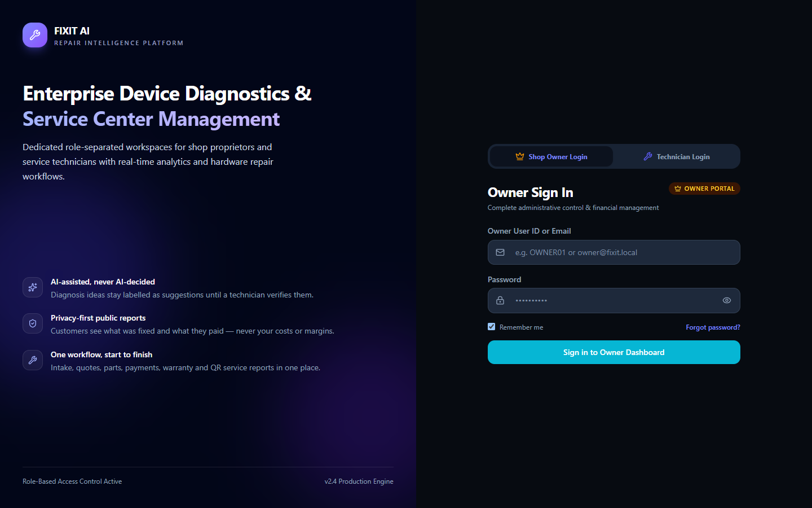 | 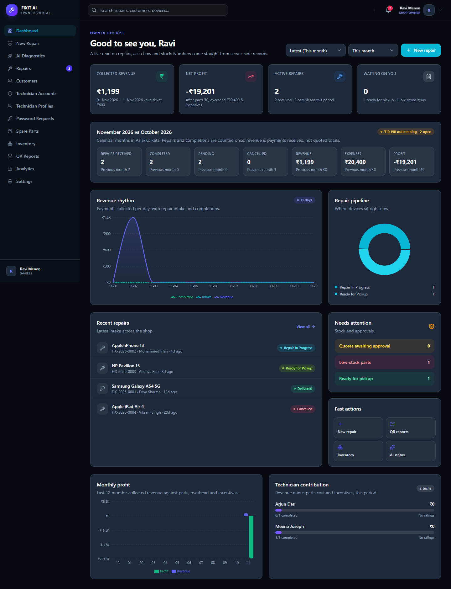 |
| *Portal login — owner and technician use the same page* | *Owner dashboard with live KPIs* |
| 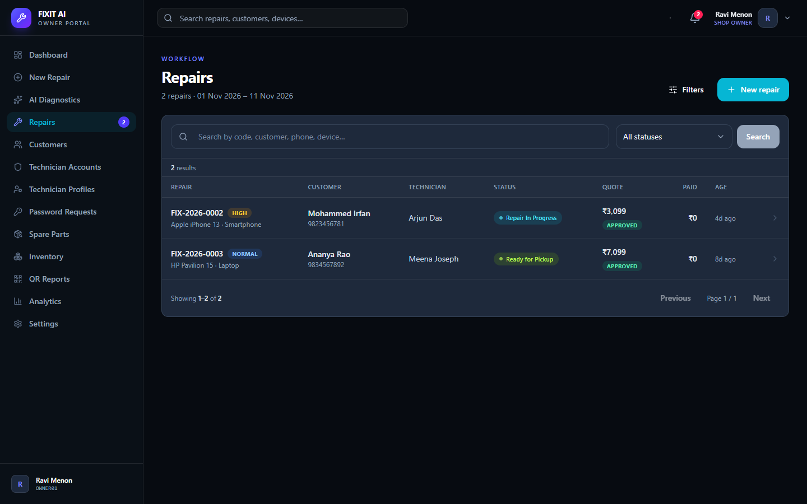 | 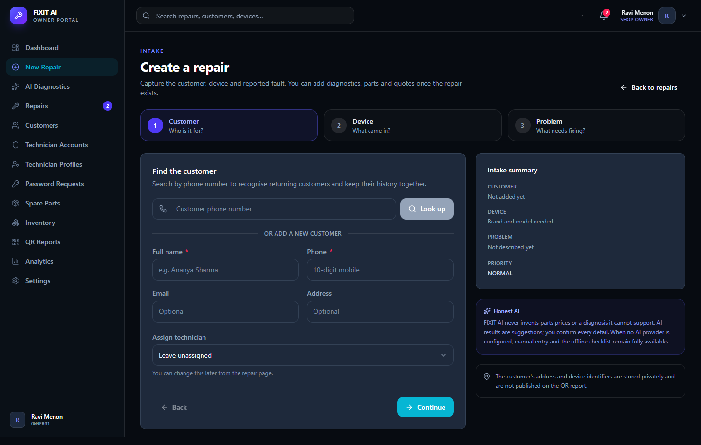 |
| *Repair jobs board with status filters* | *Guided intake wizard: customer → device → problem → photos* |
| 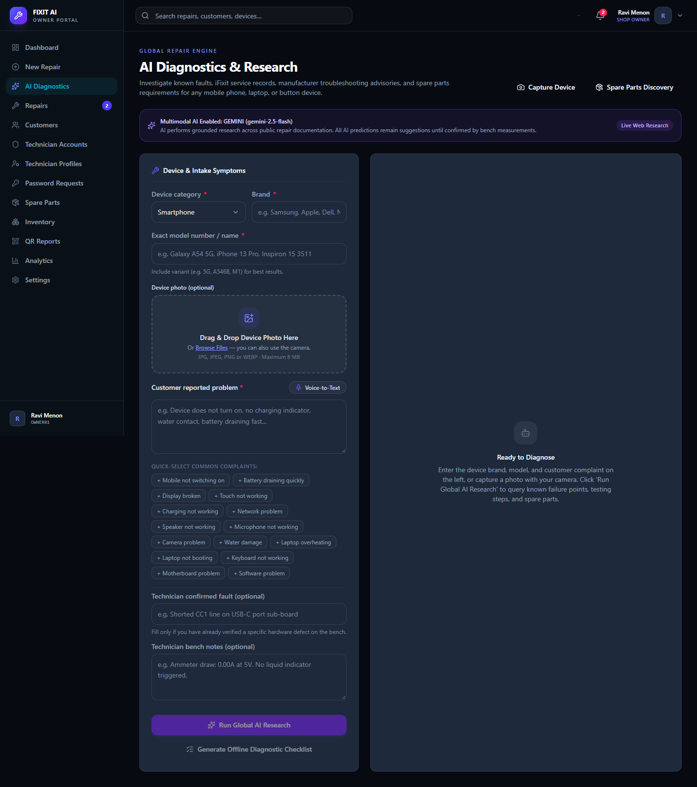 | 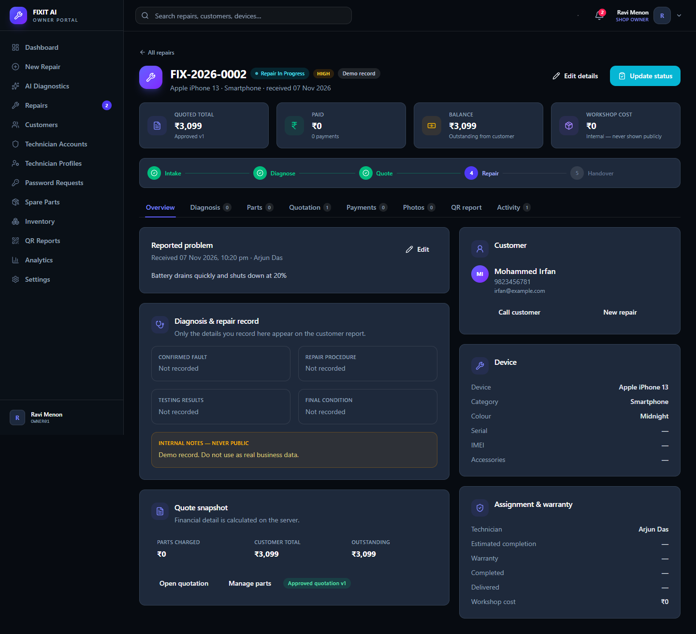 |
| *AI diagnostics with checklist fallback* | *Repair detail: overview, diagnosis, parts, quote, payments* |
| 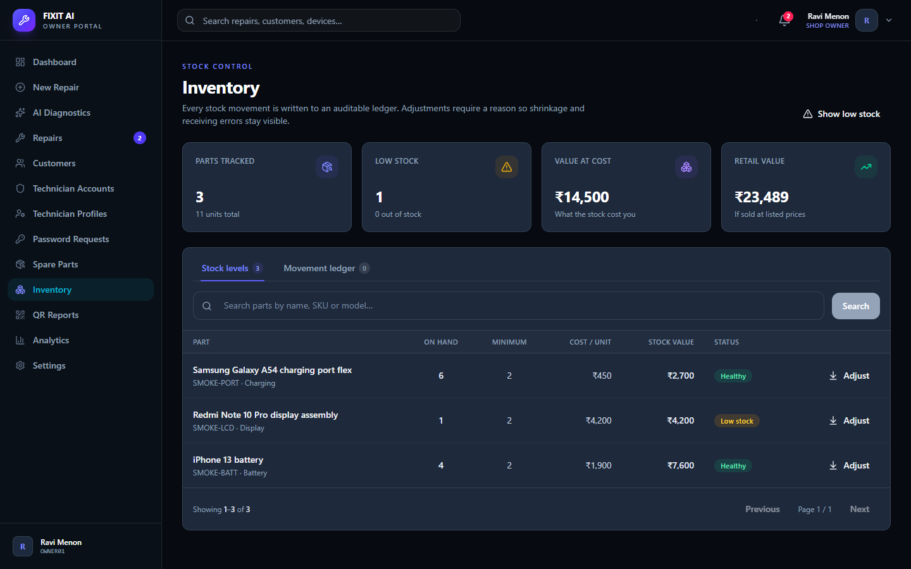 | 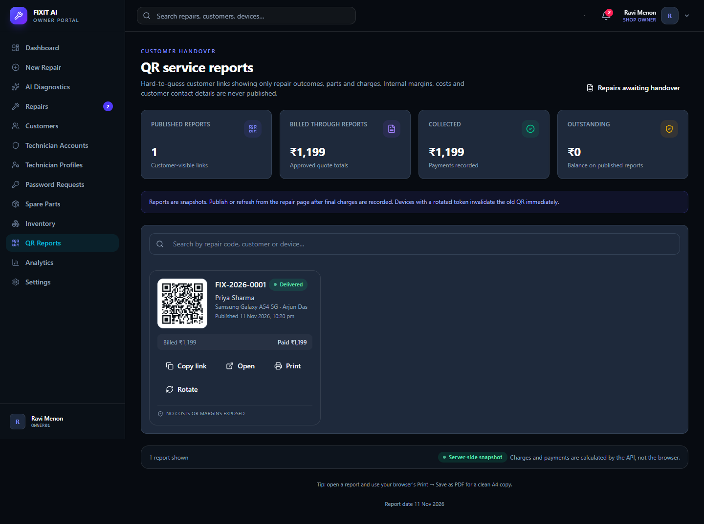 |
| *Stock levels, low-stock alerts, valuation* | *Published service reports with QR codes* |
| 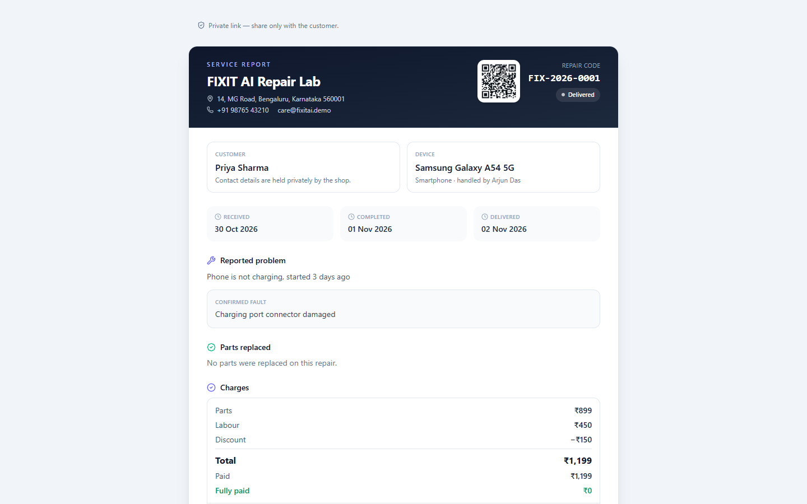 | 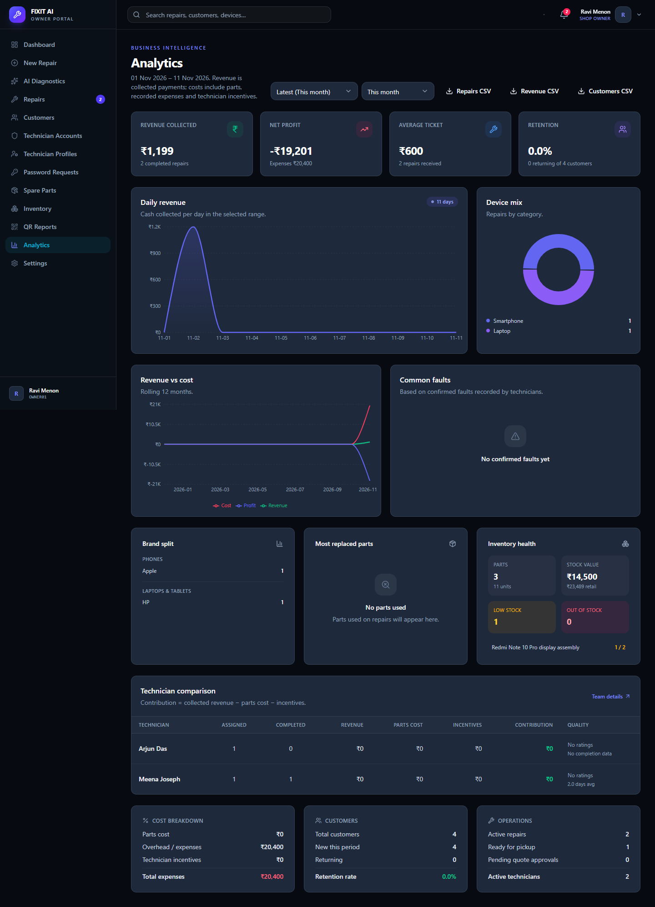 |
| *Customer-facing report opened from a QR code — no internal costs* | *Revenue, profit and performance analytics* |
| 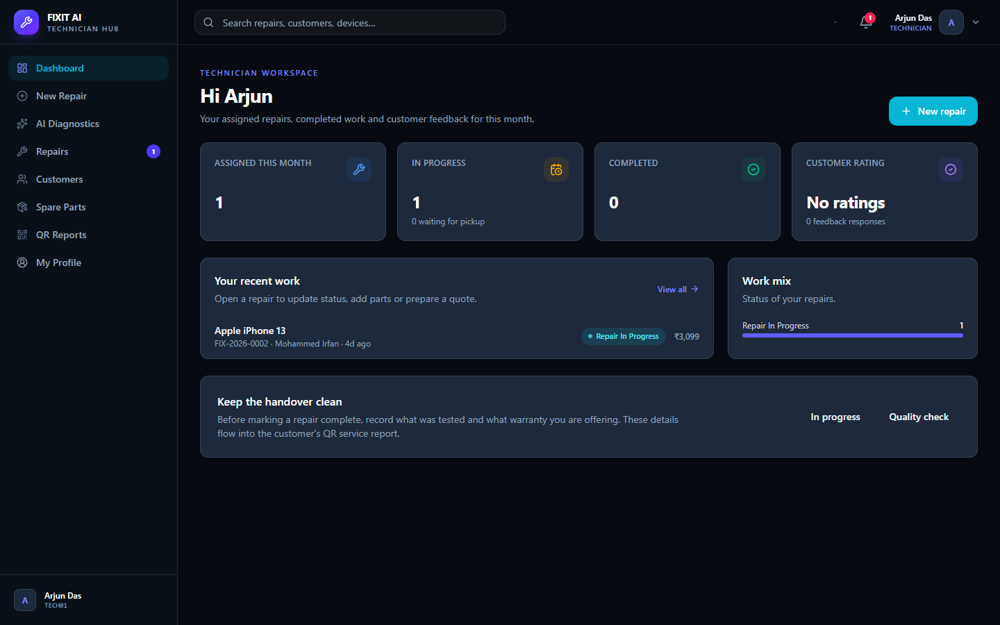 | 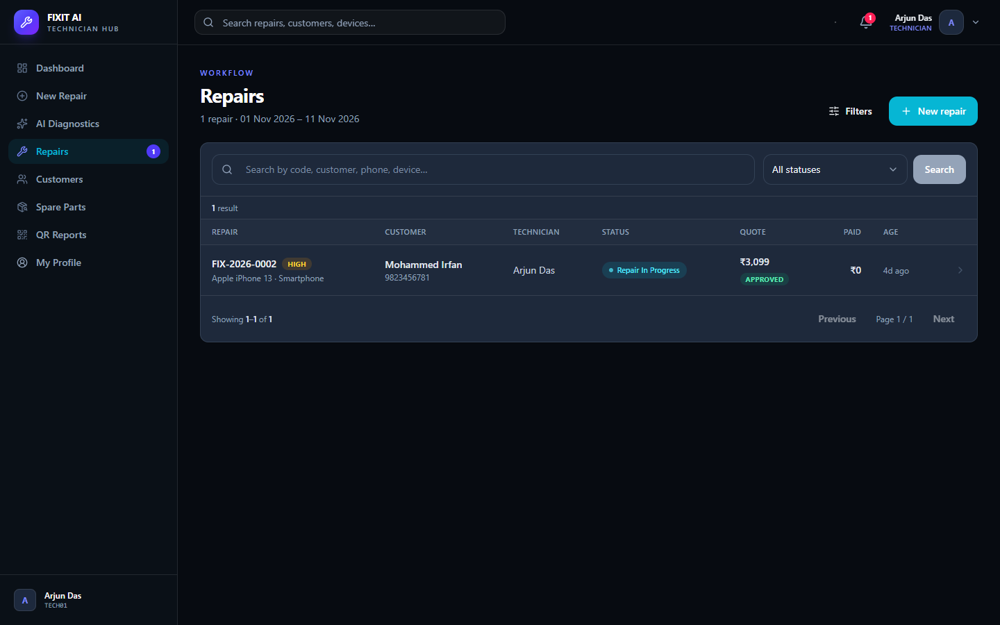 |
| *Technician portal — only assigned work* | *Technician's own job list* |

## Key features

**Accounts & security**

- Owner + technician accounts with User IDs and email login, salted **scrypt** password hashes,
  and a forced password change on first login
- 7-day signed session cookie (`httpOnly`, `sameSite=lax`, `secure` in production)
- Login rate limiting, helmet security headers, zod-validated request bodies
- Portal boundary: a technician cannot sign into the owner portal (and vice-versa) even with
  valid credentials

**Repair workflow**

- Guided intake wizard: find/create customer → register device → describe problem → attach photos
- Automatic repair IDs (`FIX-2026-0001`, `FIX-2026-0002`, …)
- 14 statuses with a validated state machine (`server/lib/constants.ts`); technicians advance
  along the flow, the owner may also correct mistakes (every change is audited)
- Quotations with parts + labour, owner approval thresholds, customer approval, payments
  (multiple allowed), delivery — then a published service report

**AI diagnostics** *(optional, Google Gemini)*

- Device identification from a photo
- Guided diagnosis from the reported complaint + photos, stored as a *suggestion* with provider,
  model and confidence — a technician must confirm the fault before it affects quotes or money
- Clearly-labelled offline checklist when no API key is configured — the app never guesses

**Money & inventory**

- Spare parts catalogue with SKU, supplier, purchase/selling price, stock and low-stock alerts
- Parts consumed by a repair automatically deduct stock and feed the quotation's actual cost
- Expenses tracking and monthly profit (revenue − parts cost − expenses − technician incentives)

**QR service reports**

- One private, tokenised link per repair (`/r/<token>`) — printable, phone-friendly, **cost and
  profit fields excluded**
- QR code per repair; the owner can rotate the token to invalidate an old printed QR
- Customer star-rating feedback collected on the public page (once per repair, rate-limited)

**Analytics**

- Owner dashboard KPIs, month picker over closed months
- Revenue / expenses / profit charts, technician performance, repair-source and category
  breakdowns, CSV export

## Tech stack

| Layer | Choice |
| --- | --- |
| Client | React 19, TypeScript, Vite 7, Tailwind CSS 4, TanStack Query 5, Recharts 3, React Router 7 |
| Server | Node.js, Express 5, TypeScript (`tsx` runner), zod, helmet, express-rate-limit, multer, qrcode |
| Database | **Your Google Spreadsheet** — via a Google Apps Script Web App gateway |
| Data access | A Prisma-compatible query engine (`server/sheets/engine.ts`) speaking to the gateway; Prisma itself is used only as the schema/type source |
| AI | Google Gemini (`gemini-2.5-flash` by default), optional |
| Photos | Google Drive (stored by the gateway next to the spreadsheet) |

## Architecture

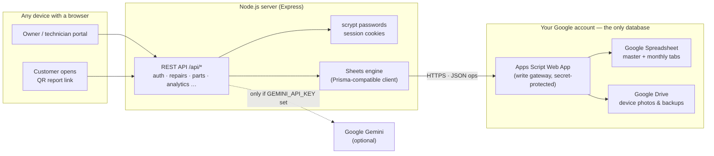

Every write is batched into Apps Script "ops" with a request ID, flushed in chunks and replayed
safely on retry, so a network hiccup can never write the same row twice.

## The Google Spreadsheet is the only database

The spreadsheet is organised so a human can still read it month by month:

| Worksheet kind | Examples | Purpose |
| --- | --- | --- |
| Masters | `Customers`, `Devices`, `Repairs Index`, `Users`, `Technicians`, `Spare Parts`, `Suppliers`, `Repair Reports`, `Settings` | Shared across all months |
| Monthly | `November 2026`, `November 2026 - Parts`, `November 2026 - Payments`, `November 2026 - Activity` | Created automatically the first time a month receives records |
| Hidden helpers | `_FIXIT_SCHEMA`, `_FIXIT_REQUESTS` | Header registry and write-once request log |

Guarantees built into the engine and gateway:

- **Update, never duplicate** — records are matched by stable ID and updated in place
- **Monthly routing** — payments, part usage and activity land in the month's own tabs, older
  months stay intact
- **Concurrency safe** — the gateway holds a script lock and replays `requestId`s, so retries
  after a lost response never double-write
- **Human-readable timestamps** — IST (`Asia/Kolkata`), formatted `DD-MM-YYYY HH:mm:ss`
- **Header safety** — the gateway refuses to touch a tab whose headers don't match the schema
- **A 4-second read cache** with automatic invalidation after every write batch

The Node server never holds business data: it reads through the gateway and writes batched ops.
SQLite files from the legacy prototype remain on disk only as a rollback archive
(see [Migrating legacy data](#migrating-legacy-data)).

## Repair lifecycle

The state machine in `server/lib/constants.ts` (technicians follow the arrows; the owner may
also correct to any status, always audited):

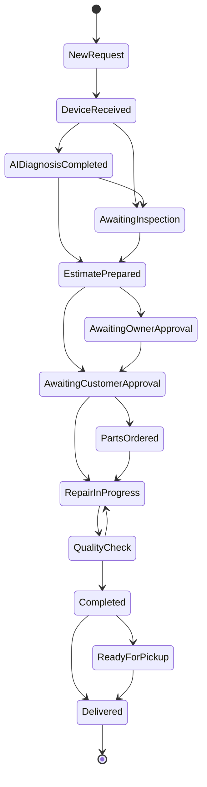

Any active status can also move to **Cancelled**. A service report can be published once the
repair reaches *Completed*, *Ready for Pickup* or *Delivered*.

## Portals

**Owner** — full business control: dashboard KPIs, all repairs, customers, technician accounts
(create/deactivate/reset passwords), technician performance, parts catalogue, inventory
valuation, expenses, QR reports, analytics, and settings (shop profile, expenses, audit log,
data & Sheets storage).

**Technician** — their work only: assigned repairs, intake of new customers/devices, photos,
AI diagnostics, confirmed faults, parts used, payments they record, status updates and report
publishing, plus their own repair history and profile.

The exact route map:

| Route | Access |
| --- | --- |
| `/login`, `/login/owner`, `/login/technician`, `/forgot-password`, `/reset-password` | Public |
| `/r/:token` | Public (customer QR report, token-protected) |
| `/dashboard`, `/repairs`, `/repairs/new`, `/repairs/:id`, `/diagnostics` | Owner & technician |
| `/customers`, `/customers/:id`, `/parts`, `/reports`, `/profile` | Owner & technician |
| `/technicians/:id` | Owner & technician |
| `/owner/technicians`, `/owner/password-requests`, `/technicians` | Owner only |
| `/inventory`, `/analytics`, `/settings` | Owner only |

## AI diagnostics

Set `GEMINI_API_KEY` (and optionally `GEMINI_MODEL`, default `gemini-2.5-flash`) to enable:

- `POST /api/ai/identify` — identify a device from a photo
- `POST /api/ai/diagnose` — structured diagnosis suggestions from complaint + photos

Behaviour when no key is set (this is a supported mode, not an error):

- `GET /api/ai/status` reports `configured: false`
- Photo identification returns `503 AI_NOT_CONFIGURED` instead of guessing
- Diagnosis falls back to the offline checklist and manual entry

Every AI result is stored as a **suggestion** with provider/model/confidence metadata and shown
clearly labelled; a technician must confirm the fault before it influences a quotation, part or
payment.

## Inventory and parts

- Parts catalogue (`/parts`) with SKU, category, quality, supplier, prices, stock, minimum stock
- Consuming a part in a repair deducts stock and records usage in the month's `- Parts` tab
- Inventory page (`/inventory`, owner) shows stock on hand, low-stock alerts and stock valuation
- Each part records its supplier (online distributor or local shop) and, for online purchases,
  the source URL for price auditing
- Purchase expenses recorded in Settings → Expenses feed the monthly profit calculation

## QR service reports

When a repair reaches *Completed*, *Ready for Pickup* or *Delivered*, the owner or technician
publishes a service report:

1. The server builds a **public-safe snapshot** (shop, customer, device, diagnosis, parts,
   charges the customer pays, payments) — purchase costs, profit and internal notes are excluded
2. The snapshot is stored with a random URL-safe token; the QR code encodes
   `<PUBLIC_BASE_URL>/r/<token>`
3. The customer opens the link on any phone — no account needed — and can print it or save it
   as PDF (`?print=1` supported)
4. The owner can **rotate the token** (old QR/link becomes invalid) from the reports page
5. The customer may submit a star-rating + comment **once** (rate-limited); the owner sees it on
   the repair page

## Dashboards and analytics

- **Dashboard** (both roles, scoped): open repairs, today's activity, low stock, revenue trends
- **Analytics** (owner): monthly revenue / expenses / profit, per-technician performance
  (jobs, revenue, incentive), repair category and source breakdowns, CSV export
- Month picker reads previous months' tabs read-only

## Requirements

- **Node.js 20+** (developed and tested on Node 24) and npm
- A Google account that **owns** the spreadsheet (free Gmail works; a Workspace account gives
  higher Apps Script quotas for a busy shop)
- Google Chrome only for the optional [screenshot capture](#local-ui-preview-harness) tool

## Quick start

### 1. Deploy the Apps Script gateway

The gateway is the only component allowed to write to your spreadsheet. The full step-by-step
guide (including screenshots-free instructions, permission notes and troubleshooting) lives in
[`server/sheets/appsscript/DEPLOY.md`](server/sheets/appsscript/DEPLOY.md). Summary:

1. Sign in to <https://script.google.com> with the account that owns your spreadsheet and
   create a **New project**
2. Open `Code.gs`, delete the sample content and paste the entire contents of
   **[`server/sheets/appsscript/Code.gs`](server/sheets/appsscript/Code.gs)**
3. At the top of the file, check the two constants:
   - `SPREADSHEET_ID` — your spreadsheet
   - `GATEWAY_SECRET` — must match `SHEETS_GATEWAY_SECRET` in `.env` (use a long random value;
     it is the only thing protecting the write gateway)
4. *(Recommended)* Run the `testGateway` function from the editor once and authorise the scopes —
   the execution log should print your spreadsheet's name and tabs
5. **Deploy → New deployment → Web app** — *Execute as: Me*, *Who has access: Anyone* — and
   authorise Sheets + Drive scopes
6. Copy the Web app URL (ends in `/exec`) — this is your `SHEETS_GATEWAY_URL`

After editing `Code.gs` later, use **Deploy → Manage deployments → edit → New version**; the URL
stays the same. A plain version bump does **not** refresh permissions — if you add scopes, create
a new deployment.

### 2. Configure the environment

```bash
copy .env.example .env      # Windows
# cp .env.example .env      # macOS / Linux
```

Set in `.env`:

```dotenv
SHEETS_GATEWAY_URL="https://script.google.com/macros/s/YOUR_DEPLOYMENT/exec"
SHEETS_GATEWAY_SECRET="<the same value as GATEWAY_SECRET in Code.gs>"
SESSION_SECRET="<a long random string — at least 32 characters>"
PUBLIC_BASE_URL="http://localhost:5173"     # match your deployment origin in production
```

Generate a strong secret with `openssl rand -hex 48` (or any password generator).

### 3. Create the login accounts

With the gateway configured, create the initial accounts in the spreadsheet:

```bash
npm install
npm run db:seed
```

`db:seed` creates exactly three accounts — the **owner** (`OWNER`) and two technicians
(`TECH01`, `TECH02`) — and nothing else (no demo data):

- Each account gets a **strong random temporary password printed to the console once** — save it
  immediately; it is never stored in plaintext anywhere
- Every account must choose its own new password at first login (`mustChangePassword`), enforced
  by the app's first-login dialog
- Re-running `db:seed` is safe: if accounts already exist it does nothing

### 4. Verify everything

```bash
npm run sheets:setup    # ping the gateway, create missing tabs (no business data)
npm run test:engine     # offline engine check — no Google account needed
npm run test:api        # HTTP sessions, write-context flush, no-false-success, route validation
npm run test:sheets     # 11-scenario live acceptance test against your spreadsheet
```

### 5. Run the app

```bash
npm run dev
```

- API on <http://localhost:4000> (`/api/health` reports database + AI status)
- Web app on <http://localhost:5173>

Sign in with the owner account and change your password when prompted. The spreadsheet gains
the master tabs plus the current month's tabs on first use.

## Environment variables

| Variable | Default | Purpose |
| --- | --- | --- |
| `SHEETS_GATEWAY_URL` | — *(required)* | Apps Script Web app `/exec` URL |
| `SHEETS_GATEWAY_SECRET` | — *(required)* | Must match `GATEWAY_SECRET` inside `Code.gs` |
| `SESSION_SECRET` | insecure dev value | Signs session cookies — **set a long random value in production** |
| `PUBLIC_BASE_URL` | `http://localhost:5173` | Your public origin: used in QR links and the CORS/origin allow-list. Must match the browser origin exactly |
| `PORT` | `4000` | API/production port |
| `NODE_ENV` | `development` | Set `production` for secure cookies and log-only reset links |
| `AI_PROVIDER` | `gemini` | AI provider (gemini) |
| `GEMINI_API_KEY` | *(empty)* | Empty = AI disabled, offline checklist mode |
| `GEMINI_MODEL` | `gemini-2.5-flash` | Gemini model |
| `EXPOSE_RESET_TOKENS` | `true` in dev, `false` in production | Dev-only: return password-reset links in API responses. In production the link is written to the server log for an administrator to deliver |
| `DEMO_LOGIN_HINTS` | `false` | Preview harness only: one-click demo login buttons on `/login`. Keep `false` |
| `UPLOAD_DIR` | `server/uploads` | Local upload staging (photos are stored in Drive by the gateway) |
| `MAX_UPLOAD_MB` | `8` | Max device-photo upload size |
| `DATABASE_URL` | `file:./dev.db` | **Legacy SQLite only** — read by the one-time import scripts; the running app never uses it |

## Scripts

npm scripts:

| Command | What it does |
| --- | --- |
| `npm run dev` | API (tsx watch) + Vite dev server together |
| `npm run dev:api` / `npm run dev:web` | Each half separately |
| `npm run build` | Vite build into `dist/client` + server typecheck |
| `npm start` | Run the server (`tsx server/index.ts`); serves the SPA from `dist/client` when present |
| `npm run typecheck` | TypeScript check for client and server |
| `npm run db:seed` | Create owner + technician accounts in the spreadsheet (see above) |
| `npm run sheets:setup` | Ping the gateway, create missing tabs, print setup help |
| `npm run db:migrate:sheets` | One-time import of legacy SQLite data into the spreadsheet |
| `npm run db:verify:sheets` | Read-only consistency check of the spreadsheet (counts, duplicates, relations) |
| `npm run test:engine` / `test:api` / `test:sheets` | Test suites (see below) |
| `npm run setup` | Alias for `db:verify:sheets` |

Helper scripts in [`scripts/`](scripts/) used by those commands and by maintainers:
`fake-gateway.ts` (in-memory gateway the engine is tested against), `ui-preview-server.ts`
(local UI harness), `capture-screenshots.ts` (regenerates `docs/screenshots/`),
`verify-logins.ts`, `live-ping.ts`, `gateway-transport-check.ts`, `redirect-debug.ts`
(gateway transport diagnostics), `api-smoke.ts`, `sheets-engine-smoke.ts`,
`test-sheets-live.ts`, `verify-sheets.ts`, `migrate-sqlite-to-sheets.ts`, `setup-sheets.ts`.

## Testing

Three layers, all runnable without touching production data except the last:

| Suite | Command | What it proves |
| --- | --- | --- |
| Engine smoke | `npm run test:engine` | The Node side of the Sheets engine — schema, staged writes, reads, relations, cascades, monthly tabs — against the in-memory gateway, no Google account needed |
| API smoke | `npm run test:api` | The HTTP layer the engine test cannot reach — session cookies, request-scoped write context, flush-before-response, the "no false success" failure path, route validation |
| Live acceptance | `npm run test:sheets` | **11 scenarios against the real spreadsheet**: gateway health & IST timezone · automatic schema/monthly worksheets · customer create read-back · concurrent duplicate blocked · idempotent upsert · repair update without duplication · monthly Parts tab stock movement · monthly Payments tab quotation/payment + outstanding · activity trail + Drive image round-trip · previous-month preservation + report publish/public read + backup · new-month tab creation |

The live suite uses its own test-prefixed records and cleans up after itself.

## Local UI preview harness

To inspect or screenshot the UI without touching the real spreadsheet:

```bash
npm run build            # the harness serves the built SPA
npx tsx scripts/ui-preview-server.ts
```

- App on <http://localhost:4000>, backed by `scripts/fake-gateway.ts` (in-memory) — your real
  spreadsheet is never contacted
- Demo accounts are seeded with a harness-only password; the one-click login buttons appear only
  when `DEMO_LOGIN_HINTS=true` (the harness default — production default is `false`)
- `npx tsx scripts/capture-screenshots.ts` regenerates all screenshots in
  `docs/screenshots/` via headless Chrome with hints disabled, for production-accurate captures

## Production deployment

The API serves the built SPA itself, so a single Node process is enough.

**Pre-flight checklist**

- [ ] Gateway deployed from `server/sheets/appsscript/Code.gs` with a strong `GATEWAY_SECRET`
- [ ] `.env`: `SHEETS_GATEWAY_URL` is the current `/exec` URL; secrets match
- [ ] `SESSION_SECRET` is long and random (`openssl rand -hex 48`)
- [ ] `NODE_ENV=production`
- [ ] `PUBLIC_BASE_URL` is the real HTTPS origin customers will open (used in QR links)
- [ ] `EXPOSE_RESET_TOKENS=false`
- [ ] `DEMO_LOGIN_HINTS` unset/false
- [ ] TLS terminates at a reverse proxy; an admin knows where reset links are logged

**Install, build, start**

```bash
npm ci
npm run build
npm run sheets:setup
NODE_ENV=production npm start
```

No `prisma migrate` / `db push` is needed — Prisma is only the schema/type source. If your host
skips npm lifecycle scripts, run `npm run db:generate` once.

Keep the process alive with your platform's process manager. Example systemd unit:

```ini
[Unit]
Description=FIXIT AI
After=network.target

[Service]
Type=simple
WorkingDirectory=/srv/fixit
EnvironmentFile=/srv/fixit/.env
ExecStart=/usr/bin/npm start
Restart=always
RestartSec=5
User=fixit
Group=fixit

[Install]
WantedBy=multi-user.target
```

**Reverse proxy (nginx example)**

```nginx
server {
    listen 443 ssl http2;
    server_name fixit.example.com;

    ssl_certificate     /etc/letsencrypt/live/fixit.example.com/fullchain.pem;
    ssl_certificate_key  /etc/letsencrypt/live/fixit.example.com/privkey.pem;

    client_max_body_size 10m;

    location / {
        proxy_pass http://127.0.0.1:4000;
        proxy_http_version 1.1;
        proxy_set_header Host $host;
        proxy_set_header X-Real-IP $remote_addr;
        proxy_set_header X-Forwarded-For $proxy_add_x_forwarded_for;
        proxy_set_header X-Forwarded-Proto $scheme;
    }
}
```

**Post-deploy verification**

```bash
curl -fsS https://fixit.example.com/api/health
npm run test:sheets
```

Then in a browser: owner sign-in and dashboard; technician sees only assigned repairs; create a
repair with a photo (manual entry works when AI is off); publish a report and open `/r/<token>`
in a private window (confirm no cost/profit fields appear); submit feedback once; export an
analytics CSV and match on-screen totals; create a spreadsheet backup.

### Migrating legacy data

The original SQLite file can be imported once and kept as a rollback archive:

```bash
npm run db:migrate:sheets     # upsert every row by stable ID; uploads old photos to Drive
npm run db:verify:sheets      # read-only counts, duplicate and relationship checks
```

Both refuse to run when the gateway is not configured. The import is idempotent; sessions and
password-reset tokens are intentionally not copied.

## Security

- **Passwords**: salted scrypt (64-byte hash) — plaintext is never stored or logged
- **Sessions**: signed 7-day `httpOnly` cookie, `secure` + strict origin checks in production
- **Portals**: role checks on every route and API endpoint, not just hidden UI
- **Public reports**: token-only, public-safe snapshot (no costs/profit), one feedback per
  repair, rate-limited
- **The gateway secret is the write key to your spreadsheet** — keep it long, random, and only
  in `Code.gs` + `.env` (never in the sheet, docs, or chat)
- **Password resets without email**: technicians request → owner approves → a one-time temporary
  password is shown once; owner reset links expire after one hour and (in production) are only
  written to the server log — only token hashes are stored in the sheet
- **Audit log**: owner-visible trail of sensitive actions (Settings → Audit log)
- Apps Script daily quotas apply; a busy shop may need a Google Workspace account

## Backups and recovery

- **Spreadsheet version history**: File → Version history → See version history (built in)
- **App backups**: Settings → Data & demo → *Back up spreadsheet* (owner only) copies the whole
  workbook into Drive and records an audit entry
- **Drive**: photos live in the gateway's Drive folder; the API proxies reads so permissions
  stay private
- Suggested policy: weekly backup kept 8 weeks; quarterly restore test (copy a backup, point a
  staging deployment at it with a separate secret, run `npm run db:verify:sheets`)
- Keep the legacy SQLite file until the owner signs off on the spreadsheet cutover

## Troubleshooting

| Symptom | Check |
| --- | --- |
| `SHEETS_NOT_CONFIGURED` (503) | `SHEETS_GATEWAY_URL` / `SHEETS_GATEWAY_SECRET` empty in `.env` |
| `SHEETS_REJECTED` / Unauthorized | Secret differs between `Code.gs` and `.env`, or the Web App needs a new deployment version |
| `SHEETS_BAD_RESPONSE` / HTML response | Wrong `/exec` URL, or deployment access is not **Anyone** |
| `TypeError: ContentService.createText is not a function` | The **old** gateway script was deployed — redeploy `server/sheets/appsscript/Code.gs` |
| `You do not have permission to call DriveApp…` | Deployment predates the Drive scope: run `testGateway` in the editor, authorise, then create a **new** deployment |
| `SPREADSHEET_NOT_FOUND` | The deploying Google account can't open the spreadsheet — open it once in that account |
| `GATEWAY_BUSY` | Another write is in flight; the server retries automatically |
| Gateway timeout | Very large write; requests are chunked — retry when the sheet is idle |
| Header mismatch error | A tab was renamed/edited manually — restore expected headers |
| Duplicate save blocked (409) | Correct behaviour — reload and retry |
| Login 403 `BAD_ORIGIN` | `PUBLIC_BASE_URL` must equal the browser origin |
| Cookies not set behind proxy | TLS + `X-Forwarded-Proto` needed; cookies are `Secure` in production |
| Photos missing | Drive file deleted or the gateway lost its Drive scope — re-authorise the Web App |
| Reset link never arrives | No email provider by design — check server logs, deliver manually |
| AI buttons disabled | `GEMINI_API_KEY` empty/invalid — offline checklist mode is expected |

Gateway-specific diagnostics: `npx tsx scripts/live-ping.ts` (POST-through-redirect check) and
`npx tsx scripts/gateway-transport-check.ts`.

## Project structure

```
fixit-ai-prototype/
├─ client/                    # React SPA (TypeScript)
│  └─ src/
│     ├─ components/           # Layout, upload dropzones, camera capture, UI kit, badges
│     ├─ lib/                 # api client, auth context, helpers
│     └─ pages/               # Login, Dashboard, Repairs, NewRepair, RepairDetail,
│                             # Diagnostics, Customers(+Detail), Technicians(+Detail),
│                             # OwnerTechnicianAccounts, PasswordResetRequests, Parts,
│                             # Inventory, Reports, PublicReport, Analytics, Settings,
│                             # Profile, Forgot/ResetPassword, NotFound
├─ server/                    # Express API (TypeScript)
│  ├─ routes/                 # auth, repairs, customers, technicians, parts,
│  │                          # analytics, reports (incl. public), notifications,
│  │                          # settings, ai, uploads
│  ├─ lib/                    # auth (scrypt/sessions), constants (status machine),
│  │                          # report snapshots, records, http helpers
│  ├─ sheets/                 # Sheets-only runtime: engine, gateway client, schema,
│  │  └─ appsscript/          #   Code.gs (THE gateway) + DEPLOY.md
│  └─ uploads/                # local upload staging (photos stored in Drive)
├─ prisma/                    # schema.prisma (types/metadata) + db:seed (creates login accounts)
├─ scripts/                   # setup, migration, tests, preview harness, screenshots
├─ docs/
│  └─ screenshots/            # README + USER_MANUAL images (auto-captured)
├─ legacy/                     # original static prototype (historical reference only)
├─ dist/                       # build output (dist/client served by npm start)
├─ .env.example                # documented environment template
├─ README.md                   # this file — technical/setup documentation
└─ USER_MANUAL.md              # owner & technician step-by-step manual
```

## Keeping the documentation accurate

`README.md` and `USER_MANUAL.md` are the **only** primary documentation files. They are treated
as part of the product, and this rule is binding for every future change:

1. **When a feature changes, both documents change in the same commit** — steps, screenshots,
   env vars and folder structure included
2. **Outdated content is deleted, not left to rot** — no "historical" doc files, no duplicate
   guides; anything worth keeping is folded into these two files
3. **Screenshots are regenerated with `npx tsx scripts/capture-screenshots.ts`** after UI
   changes (headless Chrome; real UI, fake gateway, no credentials visible)
4. **Every documented instruction is verified against the code before it is written** — no
   aspirational features, no secrets, no passwords, no customer data in these files
