# FIXIT AI — User Manual

Welcome! This manual explains how to use the FIXIT AI repair-shop app, step by step, in plain
language. It has two parts:

- **Part 1 — Owner manual**: everything the shop owner does
- **Part 2 — Technician manual**: everything a technician does

If you have never signed in before, start with
[Signing in for the first time (owner)](#signing-in-for-the-first-time-owner) or
[Signing in for the first time (technician)](#signing-in-for-the-first-time-technician).

> 💡 **What is FIXIT AI?** It is the app your shop uses to record customers, devices, repairs,
> spare parts and payments. Everything you enter is saved to the shop's own Google Spreadsheet —
> the same sheet you can open in Google Sheets — and device photos are stored in Google Drive.
> You can use the app from any phone, tablet or computer with a browser: just open the shop's
> app address and sign in.

---

## Table of contents

**Part 1 — Owner manual**

1. [Signing in for the first time (owner)](#signing-in-for-the-first-time-owner)
2. [Signing in again later](#signing-in-again-later)
3. [The owner dashboard](#the-owner-dashboard)
4. [Managing technician accounts](#managing-technician-accounts)
5. [Approving password reset requests](#approving-password-reset-requests)
6. [Managing customers](#managing-customers)
7. [Creating a repair job](#creating-a-repair-job)
8. [Following a repair and giving approvals](#following-a-repair-and-giving-approvals)
9. [Using AI diagnostics](#using-ai-diagnostics)
10. [Managing the parts catalogue and stock](#managing-the-parts-catalogue-and-stock)
11. [Tracking revenue, expenses and profit](#tracking-revenue-expenses-and-profit)
12. [Checking technician performance](#checking-technician-performance)
13. [Publishing QR service reports](#publishing-qr-service-reports)
14. [Viewing monthly data in Google Sheets](#viewing-monthly-data-in-google-sheets)
15. [Security: backups, audit log and your own password](#security-backups-audit-log-and-your-own-password)

**Part 2 — Technician manual**

16. [Signing in for the first time (technician)](#signing-in-for-the-first-time-technician)
17. [Your dashboard and assigned repairs](#your-dashboard-and-assigned-repairs)
18. [Registering a customer and their device](#registering-a-customer-and-their-device)
19. [Uploading device photos](#uploading-device-photos)
20. [Running AI diagnostics](#running-ai-diagnostics)
21. [Confirming the fault](#confirming-the-fault)
22. [Adding parts and recording payments](#adding-parts-and-recording-payments)
23. [Updating repair status](#updating-repair-status)
24. [Completing the repair and publishing the QR report](#completing-the-repair-and-publishing-the-qr-report)
25. [Viewing repair history](#viewing-repair-history)
26. [Changing your password / forgot password](#changing-your-password--forgot-password)

**Reference**

- [Using FIXIT AI on your Android phone](#using-fixit-ai-on-your-android-phone)
- [Repair statuses explained](#repair-statuses-explained)
- [Quick troubleshooting](#quick-troubleshooting)
- [Screenshot index](#screenshot-index)

---

# Part 1 — Owner manual

## Signing in for the first time (owner)

When the app was set up, three accounts were created: **OWNER** (you) and **TECH01**, **TECH02**
(your technicians). Each received a random temporary password — it was shown once during setup
and saved by whoever set the app up. Ask for it now if you don't have it.

1. Open the shop's app address in any browser (for example `https://fixit.example.com` — use the
   address your shop uses).
2. You land on the login page. It has two tabs: **Owner** and **Technician**.

   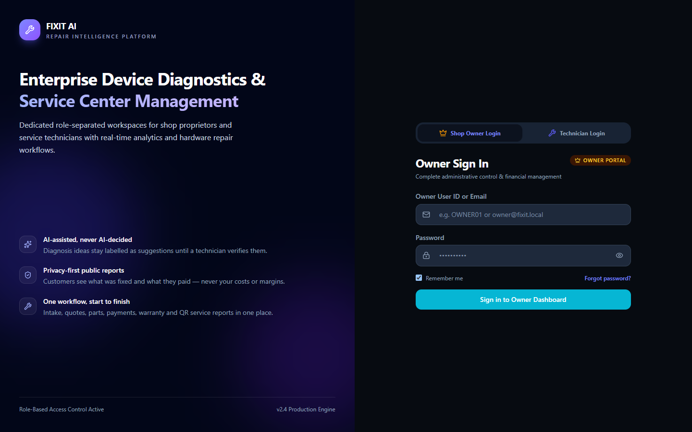

3. Make sure the **Owner** tab is selected.
4. Type your **User ID** (`OWNER`) or your account email in the first box.
5. Type the **temporary password** in the second box.
6. Click **Sign in**.
7. Because this is your first sign-in, a **Mandatory Password Update** window appears:

   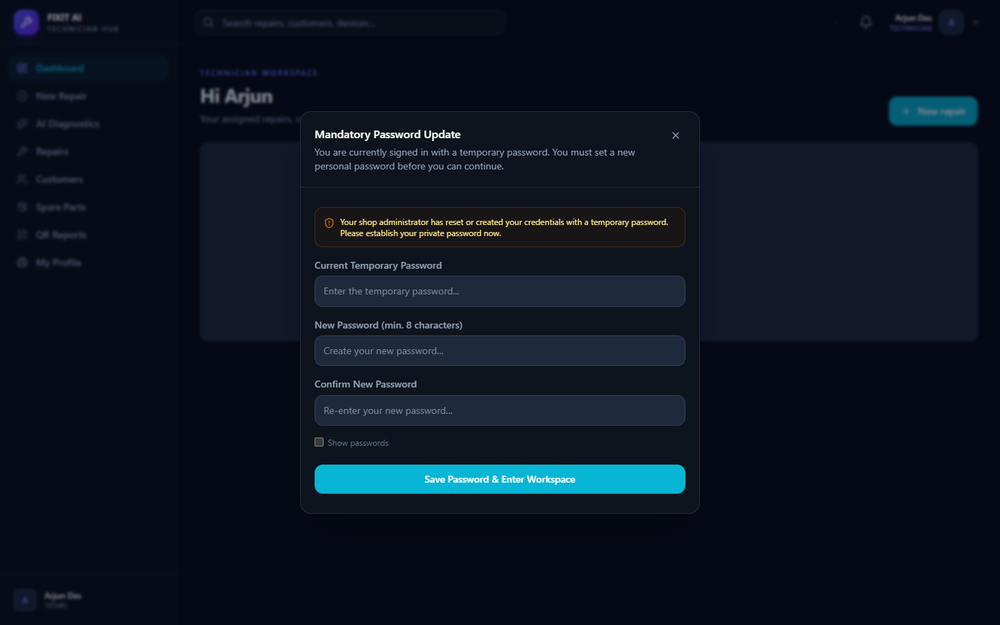

8. In that window:
   1. Type the temporary password again under **Current Temporary Password**
   2. Type your own new password under **New Password** — at least 8 characters, and make it one
      you have never used anywhere else
   3. Type the same new password again under **Confirm New Password**
   4. Click **Update Password**
9. The window closes and you are on your dashboard. **Keep your new password private** — you will
   use it every day.

> 🔒 Your password is never stored in readable form. If you lose it, use
> [Forgot password](#changing-your-password--forgot-password) — or see
> [Security](#security-backups-audit-log-and-your-own-password) for how an administrator
> recovers your account.

## Signing in again later

1. Open the shop's app address.
2. Choose the **Owner** tab, enter your User ID or email and your password.
3. Click **Sign in**. You stay signed in for 7 days on that device — after that you simply sign
   in again.

If you type a wrong password you get a clear error and can try again. After several failed
attempts the app pauses sign-ins from that device for a while — this protects the shop from
password guessing.

## The owner dashboard

After signing in you land on the **Dashboard**.

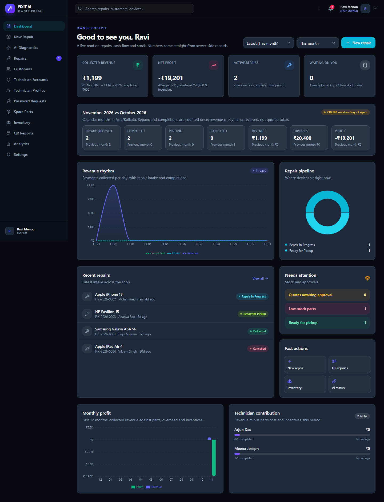

Here you see, at a glance:

- **Open repairs** — jobs that are not finished or cancelled yet
- **Today's activity** — what changed today (new jobs, payments, deliveries)
- **Low stock warnings** — parts that dropped to their minimum stock level
- **Revenue trends** — how the month is going

Use the **month picker** at the top to look at a previous month: the figures come from that
month's own spreadsheet tabs and are read-only (history never changes on its own).

From the left menu you can reach every owner area (items marked *owner only* are hidden from
technicians):

| Menu item | What it is for |
| --- | --- |
| Dashboard | Today's overview |
| New Repair | Start the 3-step intake wizard |
| AI Diagnostics | Research faults (AI or offline checklist) |
| Repairs | Every repair job, with filters |
| Customers | Customer list and their repair history |
| Technician Accounts *(owner only)* | Create / deactivate accounts, reset passwords |
| Technician Profiles *(owner only)* | Performance profiles of your technicians |
| Password Requests *(owner only)* | Technician password reset requests to approve |
| Spare Parts | Spare parts catalogue |
| Inventory *(owner only)* | Stock levels, low-stock alerts, stock value |
| QR Reports | Published service reports with QR codes |
| Analytics *(owner only)* | Revenue, expenses, profit, performance charts |
| Settings *(owner only)* | Shop profile, expenses, audit log, data & Sheets storage |
| Profile (top-right avatar) | Your own name, phone, photo and password |

For charts and business numbers, open **Analytics** (owner only):

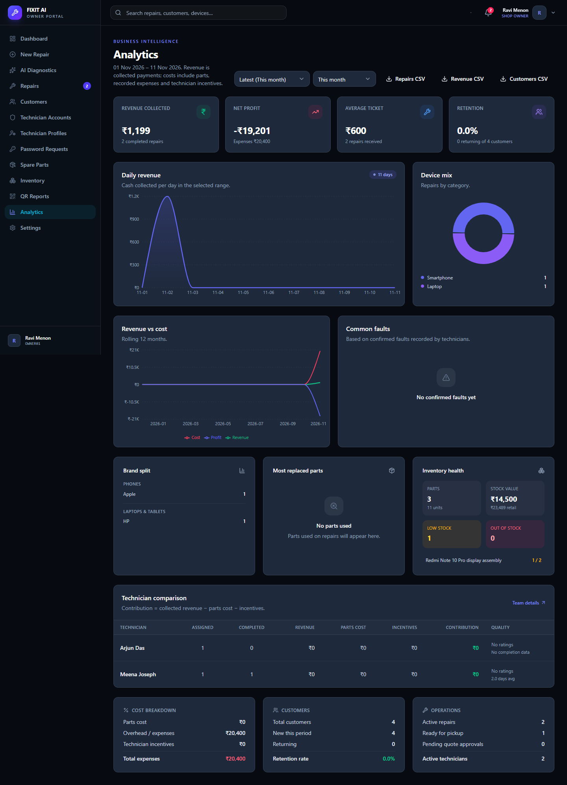

You can change the month, compare revenue vs expenses vs profit, see each technician's jobs and
incentives, and **Export CSV** to open the numbers in a spreadsheet program.

## Managing technician accounts

Only the owner can manage accounts. Open **Technician Accounts** from the left menu (owner
only).

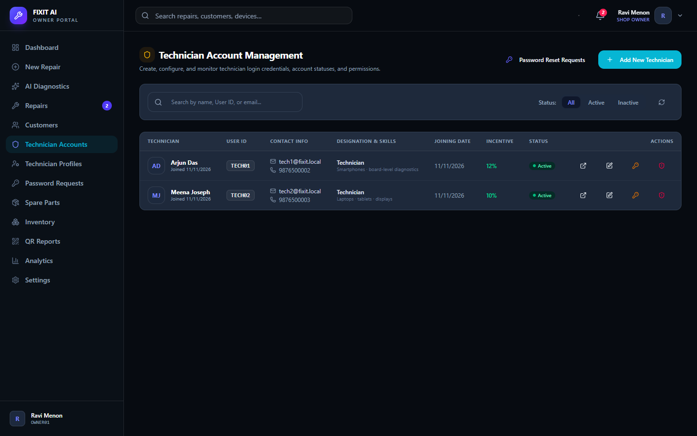

**Create a new technician account**

1. Click **Add Technician** (top right). A window opens:

   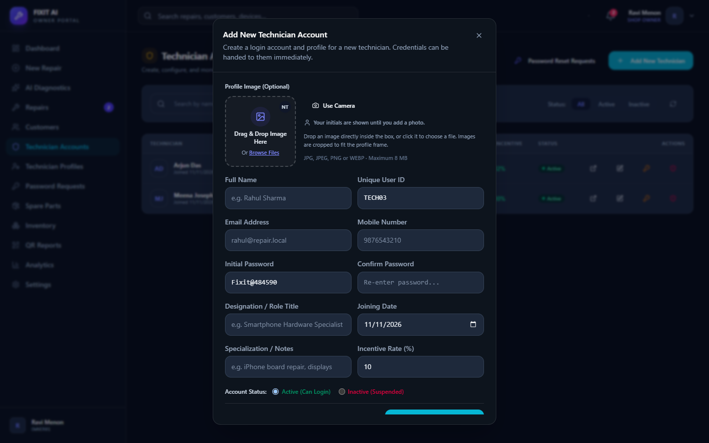

2. Fill in the technician's **name**, **User ID** (for example `TECH03`), **email** and
   **phone**.
3. Click **Create**. The app generates a strong random **temporary password** and shows it to you
   **once** — copy it and hand it to the technician personally (not by chat, if you can avoid it).
4. The technician uses it to sign in and is immediately asked to choose their own password
   (see [Part 2, step 1](#signing-in-for-the-first-time-technician)).

**Deactivate or reactivate an account**

- Use the toggle / **Deactivate** action next to a technician. A deactivated account cannot sign
  in, but the technician's past repairs and records stay untouched.
- Reactivate the same way if they return.

**Reset a technician's password**

- Click **Reset Password** next to the technician. The app creates a new temporary password,
  shows it to you **once**, and the technician is asked to set a new one at the next sign-in.

## Approving password reset requests

When a technician forgets their password, they submit a request from the login page
(see [Forgot password (technician)](#changing-your-password--forgot-password)). It arrives here:

Open **Password Requests** from the left menu (owner only).

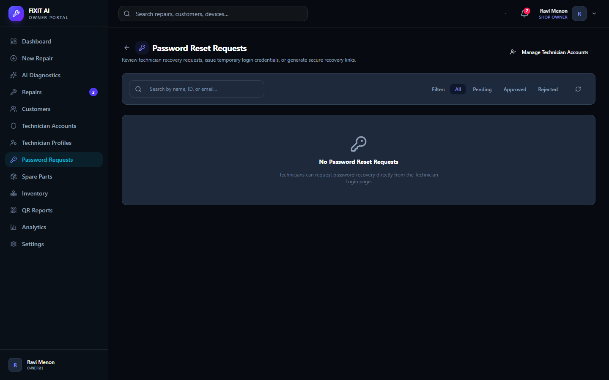

1. Read the request — it shows which technician asked and their note.
2. Click **Approve**.
3. The app shows a **one-time temporary password** — copy it and give it to the technician
   personally. They will be asked to choose their own password at the next sign-in.
4. If the request looks wrong (for example someone you don't recognise), click **Reject**.

## Managing customers

Open **Customers** from the left menu.

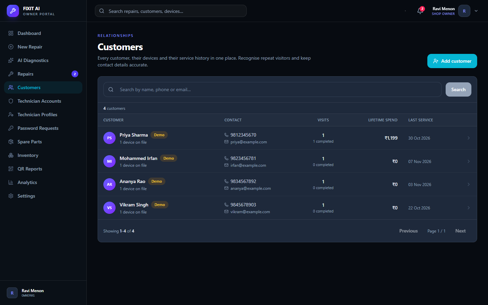

- Use the **search box** to find a customer by name, phone number or email.
- Click a customer to open their page: contact details, devices and their full repair history.

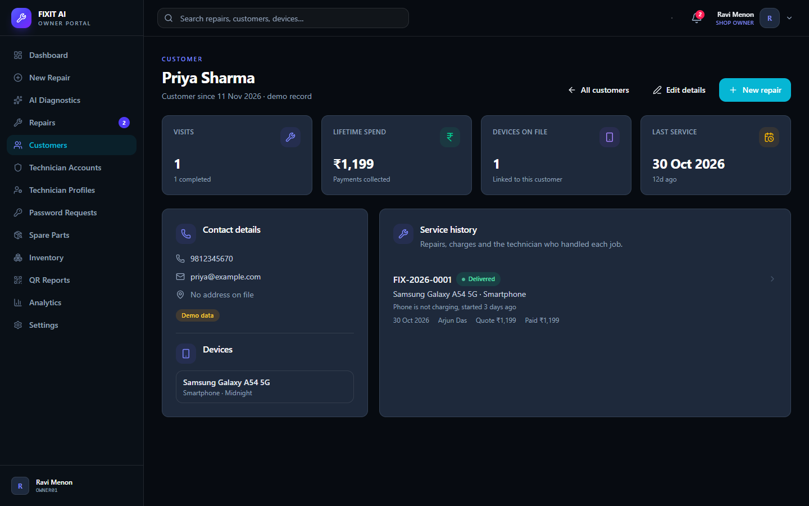

- Click **Add customer** to record a new one — name and phone are enough to start.
- You normally don't need to create customers here: the repair wizard finds or creates the
  customer automatically (next section).

## Creating a repair job

There are two ways to start a repair:

- Click **New Repair** on the dashboard or repairs page
- Or open **Repairs → New Repair** from the left menu

The wizard has three simple steps, shown at the top: **Customer → Device → Problem**.

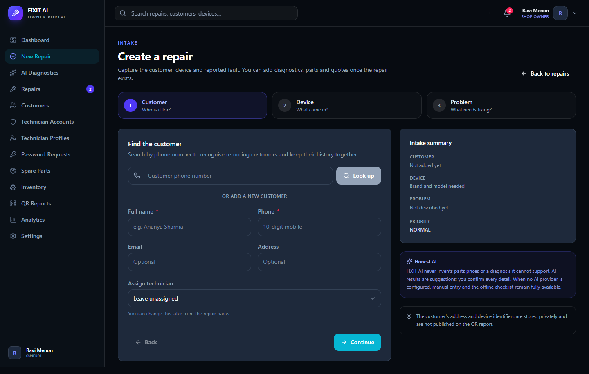

**Step 1 — Customer ("Who is it for?")**

1. Type the customer's **phone number** (or name) — the app searches as you type.
2. If the customer exists, pick them from the list. If not, type a name and phone number to
   create a new customer right here.

**Step 2 — Device ("What came in?")**

1. Choose the **category** (Smartphone, Laptop, Tablet, Keypad Phone, Other).
2. Enter the **brand** and **model** (for example *Samsung*, *Galaxy A54 5G*). With a photo
   attached and AI configured, **Suggest Details from Photo** can fill these in — always
   verify before saving.
3. If the customer's device is already known, pick it from the list instead.
4. Optionally record the colour, IMEI or serial number — useful for warranty and to prove which
   exact device is in the shop.

**Step 3 — Problem ("What needs fixing?")**

1. Type what the customer reported, in their own words — for example
   *"Phone is not charging, started 3 days ago."*
2. Add **photos** of the device if you have them (drag them onto the photo box, or click to
   pick files from the phone/computer — see
   [Uploading device photos](#uploading-device-photos)).
3. Pick the **Assign technician** who will work on the job (you can change this later from the
   repair page).
4. Click **Create repair**.

The app gives the job a unique ID like `FIX-2026-0001` and it appears in the repairs list with
status **New Request**.

> 📌 Any staff member (owner or technician) can create the repair this way.

## Following a repair and giving approvals

Open **Repairs** from the left menu to see every job.

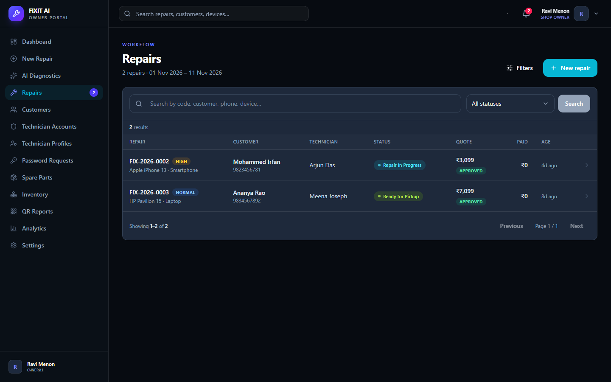

- Filter by **status**, search by customer or repair ID (`FIX-…`).
- Click any repair to open its page. The page is organised in tabs:
  **Overview, Diagnosis, Parts, Quotation, Payments, Report, Activity**.

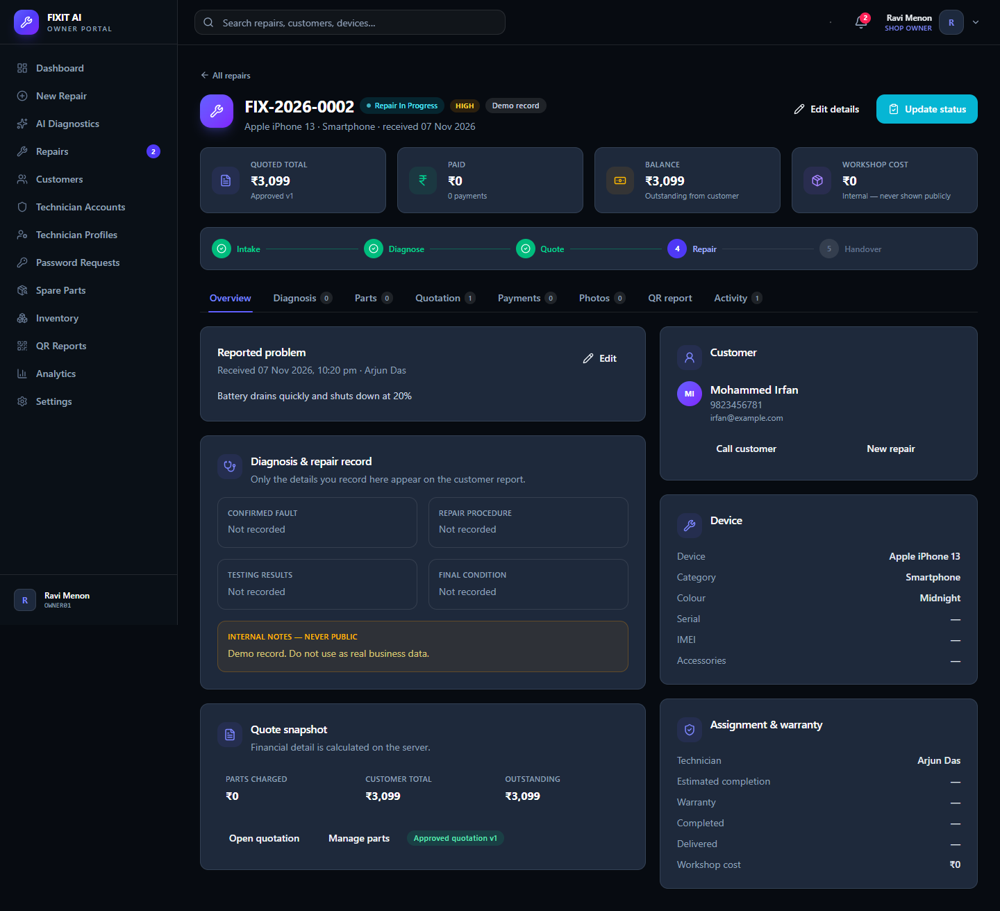

**What you do as the owner**

- **Approve quotes**: when a technician prepares the quotation and the job needs your approval
  (for example a repair above the price you set in Settings → Shop profile), the status shows
  *Awaiting Owner Approval*. Open the **Quotation** tab, review parts + labour + total, and
  click **Approve quotation**. The job then waits for the customer's decision.

  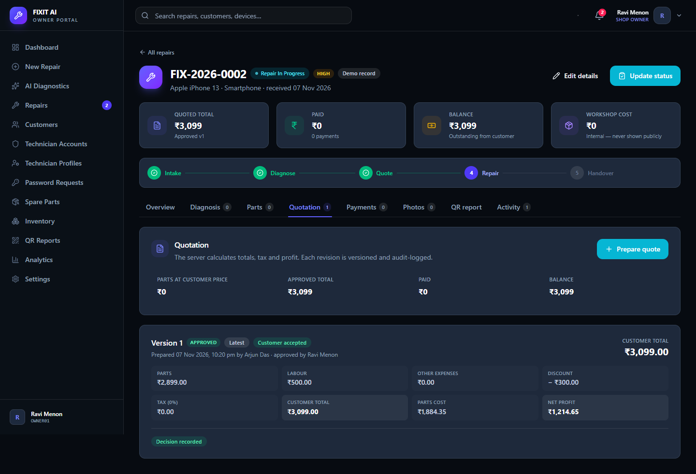

- **Watch the money**: the **Payments** tab shows every payment recorded against the job
  (method, reference, date) and the balance still to collect.

  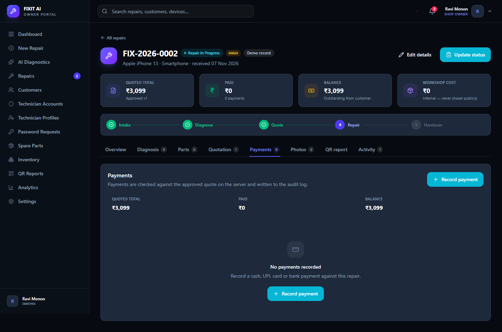

- **See everything that happened**: the **Activity** tab is a full audit trail — who changed
  what and when.

  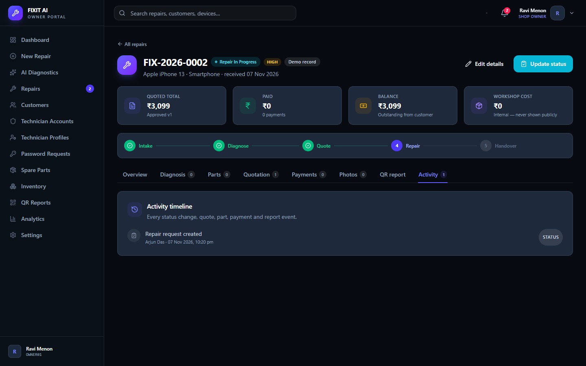

- **Correct mistakes**: as the owner you can move a repair to any status (every change is
  recorded in the audit trail). Technicians can only move forward along the normal flow.

For the technical steps (diagnosis, parts, completion), see the same-named sections in
[Part 2](#running-ai-diagnostics) — they work the same for you.

## Using AI diagnostics

There are two places to run diagnostics:

- The **AI Diagnostics** page from the left menu — research a fault for any device, even before a
  repair ticket exists
- A repair's **Diagnosis** tab — results are linked to that job automatically

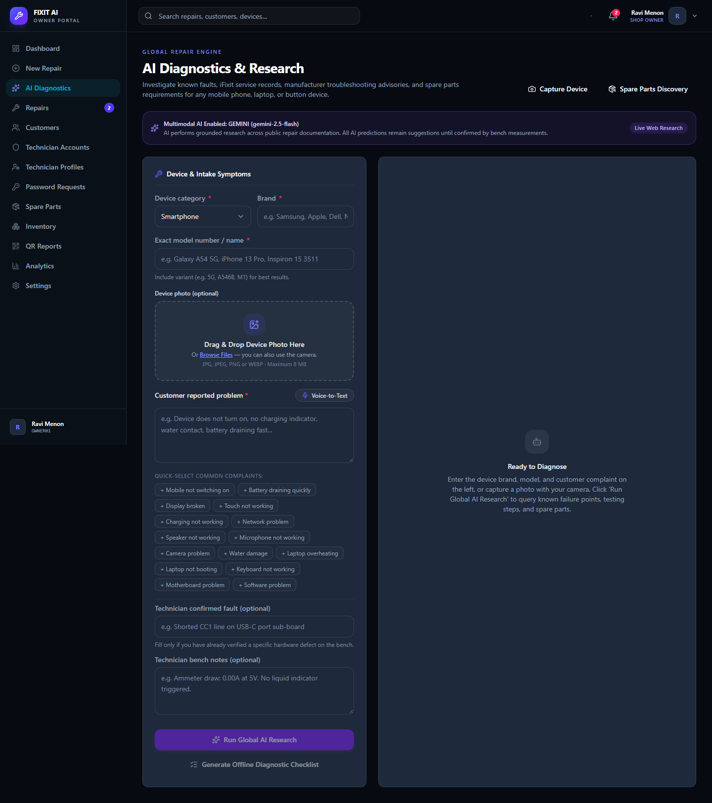

**On the AI Diagnostics page**

1. Click **Capture Device** and take/upload a photo of the device. If AI is configured, it
   recognises the brand and model and fills them in — always double-check against the device in
   your hand. Without AI, the photo is still attached and you type the details manually.
2. Enter the **category**, **brand**, **model** and the **problem** in their words.
3. Optionally add technician bench notes and any already-confirmed fault.
4. Click **Run Global AI Research** (AI mode) or **Generate Offline Diagnostic Checklist**
   (always available). Both produce a structured list of likely causes and verification tests.
5. If you opened the page from a repair (or picked the repair in the page), the findings are
   linked to that job's ticket.

**On a repair's Diagnosis tab**

- Click **Generate checklist** for the offline checklist, or **Run AI research** when AI is
   configured.
- If the job is still in an early status, running a diagnosis automatically moves it to
  *AI Diagnosis Completed*.

> 🤖 **If AI is not configured** (the shop left the AI key empty or it expired) the AI buttons
> show "AI not configured" and the page says so clearly. You can still work normally: the
> offline checklist and manual entry always work. The app never invents an AI answer.
>
> **AI results are only suggestions** — labelled as unverified. A human must confirm the real
> fault (see [Confirming the fault](#confirming-the-fault)).

## Managing the parts catalogue and stock

**Spare Parts** — open **Spare Parts** from the left menu (owner and technicians). The page is
called **Parts & Sourcing** and has two tabs.

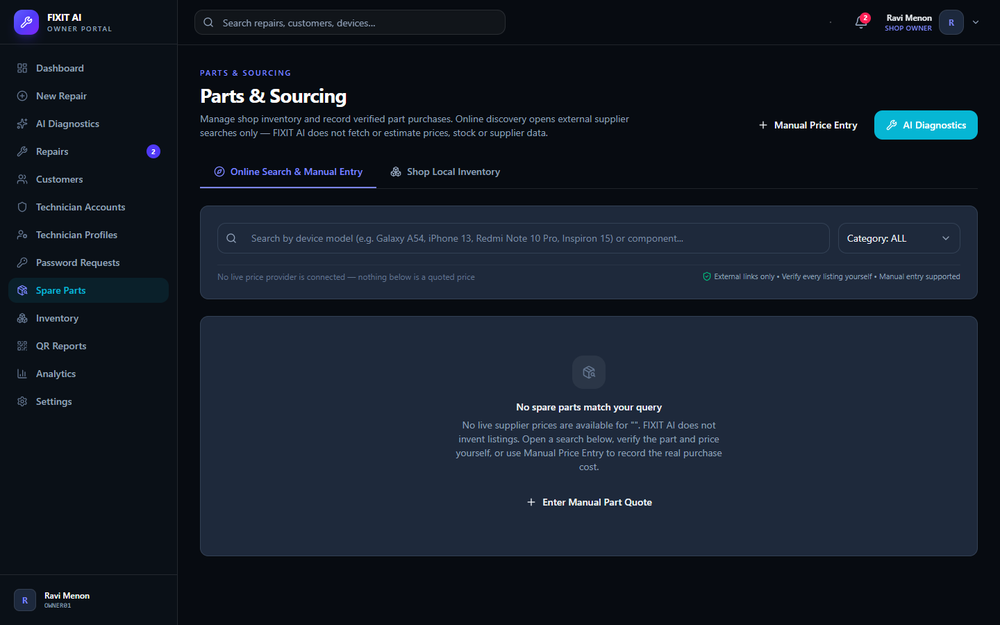

**Tab 1 — Online Search & Manual Entry**

1. Search by device model (for example *Galaxy A54*) or component (for example *charging port*).
2. The page opens **external supplier searches** — click a supplier button to search that shop's
   website yourself. FIXIT AI never fetches or invents prices, stock levels or supplier data, so
   what you see there is always the real market.
3. Any part the shop has already recorded appears as a card: quality (OEM / Compatible /
   Refurbished), category, compatible models, supplier, and the **landed cost** (price including
   shipping) you recorded when you bought it.
4. Two buttons on each card:
   - **To Inventory** — import the part into the shop's local catalogue (it sets a suggested
     retail price; adjust it as you like)
   - **Add to Repair** — attach the part straight to an active repair ticket: pick the job, the
     quantity and the selling price to the customer, then **Add to Quotation**
5. **Manual Price Entry** (top right) opens the *Add Custom Spare Part* window — use it whenever
   you buy a part, online or from a local market store:
   1. Choose **Online Purchasing** (a product URL is required, for transparency) or
      **Offline Store Purchasing** (no URL needed)
   2. Enter the part title, category, quality grade, compatible models, supplier, the real
      **landed cost** you paid, and the selling price
   3. **Save Spare Part**. From then on inventory, quotations and profit use the actual cost.

**Tab 2 — Shop Local Inventory**

- The shop's own catalogue: SKU & part name, quality, compatibility, stock badge, **Cost** (only
  the owner sees purchase cost), and **Retail Price**.
- **Full Inventory Console** (top right) opens the full stock console described next.

**Inventory** — open **Inventory** from the left menu (owner only).

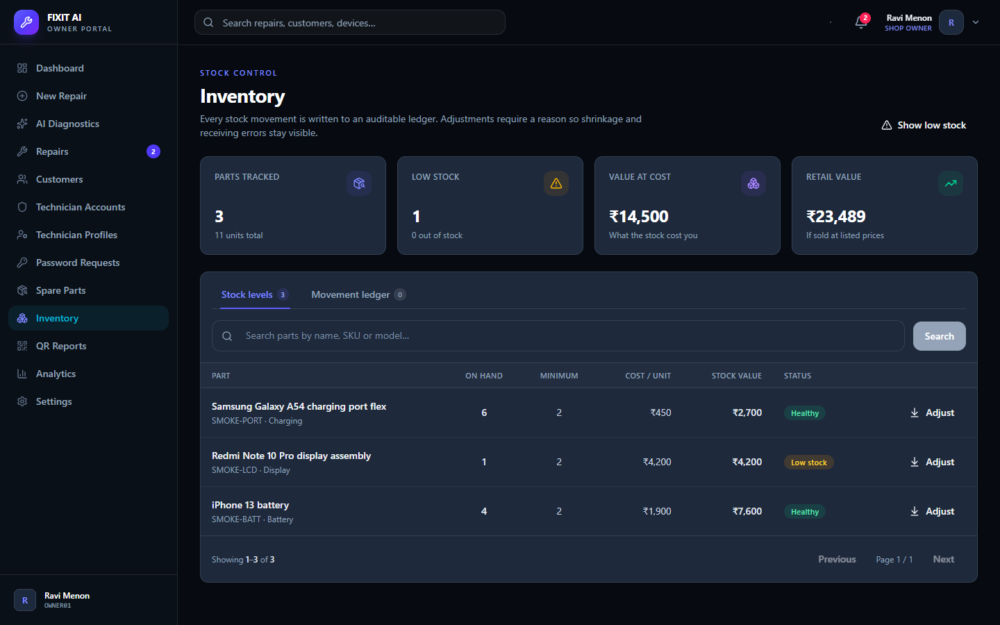

- The four summary cards show **Parts tracked**, **Low stock** (and how many are out of stock),
  **Value at cost** (what the shelf cost you) and **Retail value** (what it sells for).
- The **Stock levels** tab lists every part: on hand, minimum, cost per unit, stock value and a
  status badge — *Healthy*, *Low stock* or *Out of stock*. Use the search box or the
  **Show low stock** toggle to filter.
- To record a delivery, damage or a recount, click **Adjust** next to a part:
  1. Choose the movement type: **Stock in** (received), **Stock out** (used/lost) or
     **Set count** (after a physical count)
  2. Enter the quantity and (optionally) the unit cost — it defaults to the recorded
     purchase price
  3. Write the reason in the note box (supplier, invoice number, damage…) — it is kept for audit
  4. **Record movement**. The stock changes immediately and the movement is saved with your name
     and the time.
- The **Movement ledger** tab shows every stock movement ever recorded: type, quantity, note,
  who made it and when — nothing is deleted, so shrinkage and receiving errors stay visible.
- When someone adds a part to a repair, stock goes down **automatically**, an *Out* movement
  ("Used in FIX-…") is written to the ledger linked to that job, and you get a **low-stock
  notification** the moment a part reaches its minimum.

## Tracking revenue, expenses and profit

1. Open **Settings** from the left menu (owner only) and go to the **Expenses** tab.

   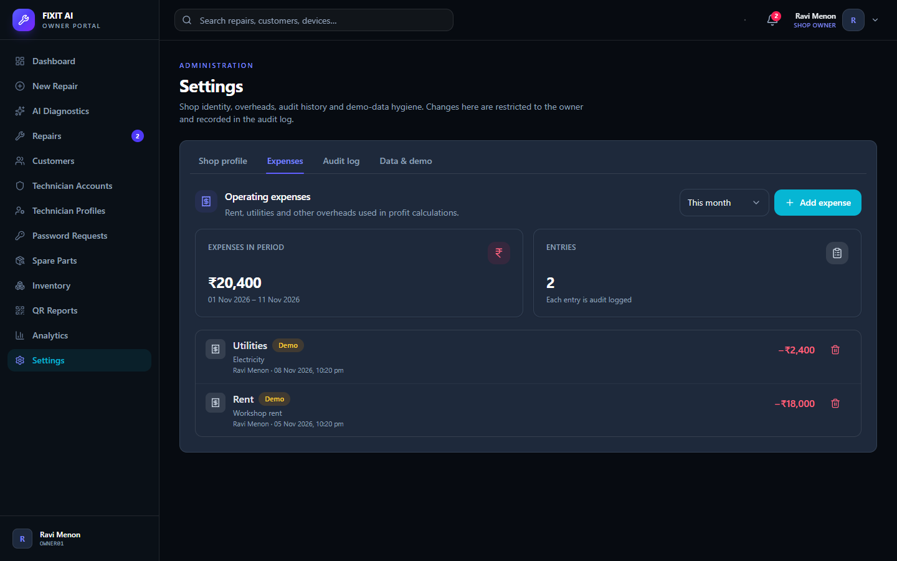

2. Click **Add expense** to record shop costs: rent, electricity, tools, part deliveries,
   marketing… Enter the amount, date and a short description.
3. Open **Analytics** to see the complete money picture for any month:
   - **Revenue** — what customers paid (recorded on repairs)
   - **Parts cost** — purchase price of parts used in repairs
   - **Expenses** — the shop costs you entered here
   - **Technician incentives** — calculated per job
   - **Profit** — revenue minus all of the above
4. Click **Export CSV** to download the numbers for your accountant.

> 💡 Every payment is recorded by whoever collects it on the repair's **Payments** tab. Recording
> a payment is a real money action: always type the amount exactly as collected.

## Checking technician performance

Open **Technician Profiles** from the left menu (owner only).

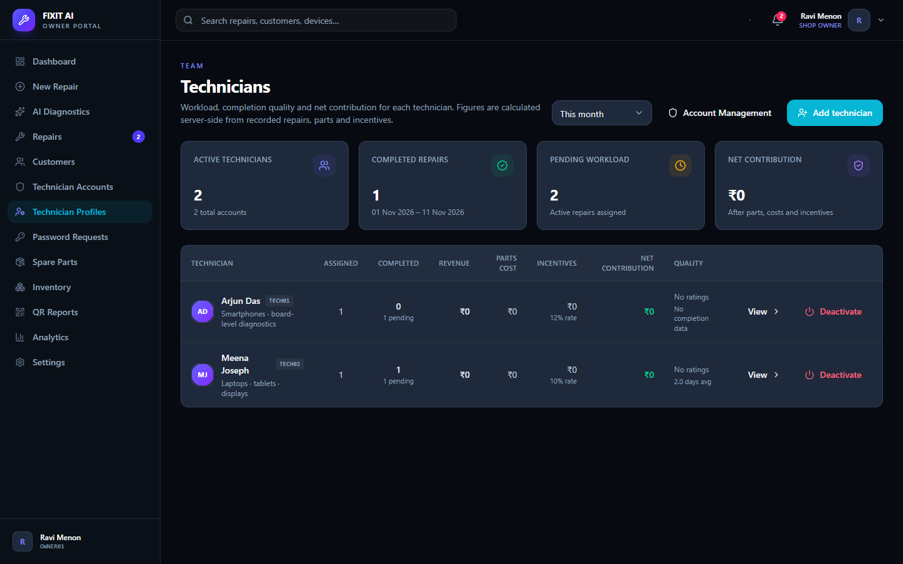

- See each technician's specialisation, active status and key numbers.
- Click a technician for their full profile: assigned repairs, completed jobs, revenue and
  incentive totals.

  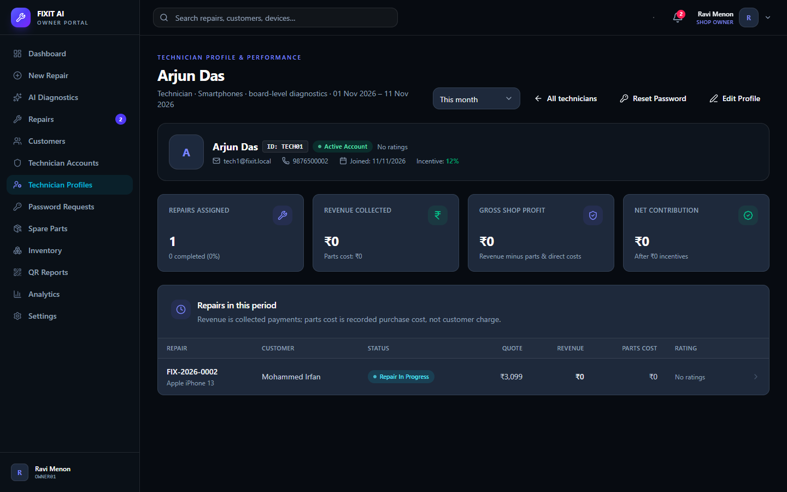

## Publishing QR service reports

When a repair is finished (*Completed*, *Ready for Pickup* or *Delivered*), anyone working the
job can publish the customer report — see
[Part 2, completing a repair](#completing-the-repair-and-publishing-the-qr-report). As the owner
you also have the **QR Reports** page:

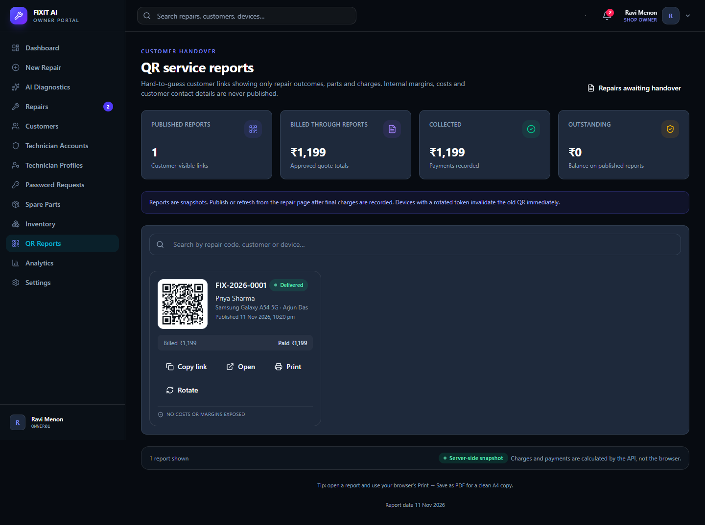

- Every published report is listed with its repair, customer, technician, billed and paid
  amounts — and its **QR code is shown right on the card**. Scan it with any phone camera to
  preview the report, or print the card for the customer's bill.
- The buttons on each report card:
  - **Copy link** — copies the private report link
  - **Open** — shows the same page the customer will see:

    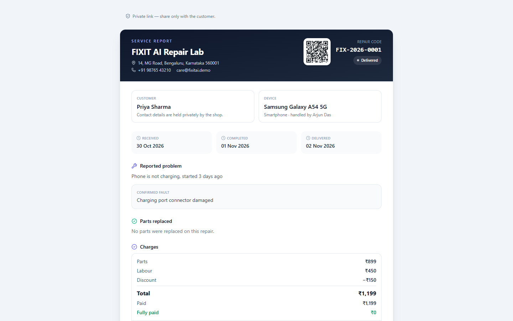

  - **Print** — opens the report in print mode
  - **Rotate** (owner only) — creates a fresh token: the old printed QR/link stops working and
    only the new one opens the report. Use this if a customer says the wrong person got hold
    of the link.

The customer's page is phone-friendly and printable. It shows the shop details, device,
diagnosis, parts used, the amount the customer pays and payments so far — **never** your
purchase costs or profit.

## Viewing monthly data in Google Sheets

The app's database *is* your Google Spreadsheet — the one named *"Data Storage"*. Open it in
Google Sheets any time:

- **Master tabs** (shared across all months): `Customers`, `Devices`, `Repairs Index`, `Users`,
  `Technicians`, `Spare Parts`, `Suppliers`, `Repair Reports`, `Settings`
- **Monthly tabs** — created automatically each month: `November 2026` (repairs),
  `November 2026 - Parts`, `November 2026 - Payments`, `November 2026 - Activity`
- Two hidden helper tabs (`_FIXIT_SCHEMA`, `_FIXIT_REQUESTS`) protect the data — do not edit or
  delete them.

**Rules for working in the sheet directly**

- ✅ Reading, filtering, colouring rows, adding notes in a separate column — fine
- ✅ Making a copy (File → Make a copy) — fine, it's a great backup
- ⚠️ **Do not rename tabs or header rows** — the app checks headers and will refuse to touch a
  tab that doesn't match
- ⚠️ **Do not edit rows while someone is using the app** — prefer reading; let the app do the
  writing
- ❌ Never delete the hidden `_FIXIT_…` tabs

Timestamps in the sheet are in Indian Standard Time, written like `11-11-2026 14:05:30`.

> 🧾 In the app, **Settings → Data & demo** also shows your Sheets storage status and lets you
> create a full backup copy of the workbook into Google Drive (see
> [Security](#security-backups-audit-log-and-your-own-password)).

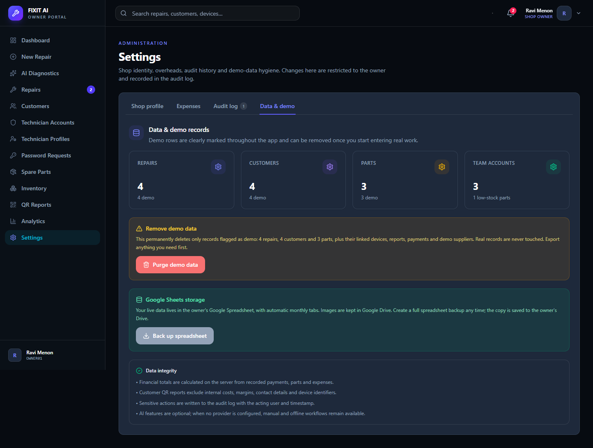

## Security: backups, audit log and your own password

**Backups**

1. Open **Settings → Data & demo** (owner only).
2. Click **Back up spreadsheet**. The app copies the entire workbook into Google Drive and
   records an audit entry.
3. Also available at any time: Google Sheets **File → Version history** shows every change ever
   made to the sheet, and **File → Make a copy** creates a snapshot.

A weekly backup kept for two months is a good habit.

**Audit log**

Open **Settings → Audit log** (owner only) to see who did what and when — account changes,
approvals, report publishing, backups. Use it whenever something looks unexpected.

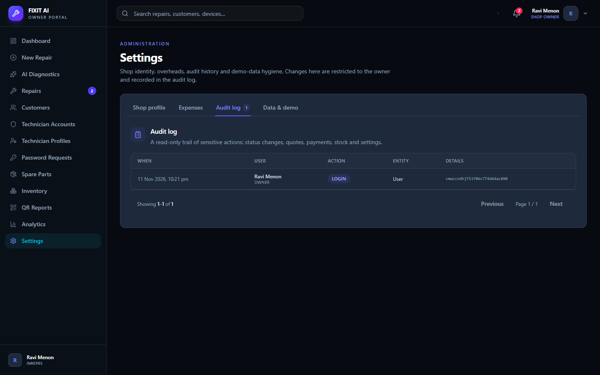

**Shop profile**

Settings → **Shop profile** holds the shop name, address, phone, GSTIN and the price above
which repairs need your approval. It feeds the customer report header — keep it current.

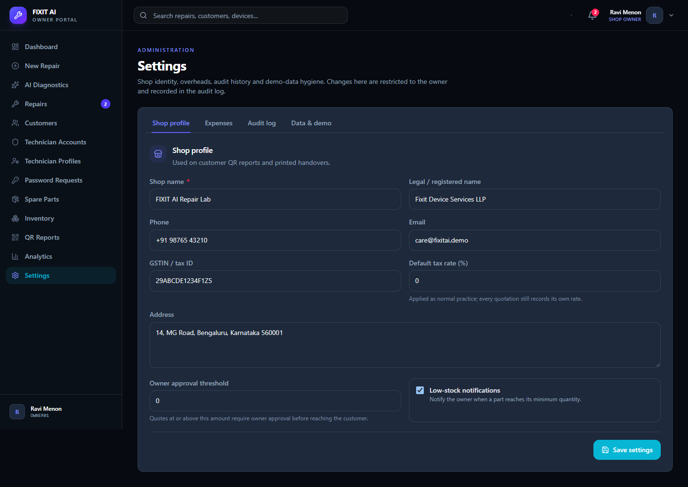

**Your own password**

- To change it while signed in: open **Profile** (top-right of the app) and set a new password
  there.
- If you forgot it: on the login page click **Forgot password?**, choose the **Owner** card,
  enter the email registered to your account, and follow the reset link (it is valid for one
  hour; in production setups it is delivered to you by the shop administrator rather than shown
  in the browser).

  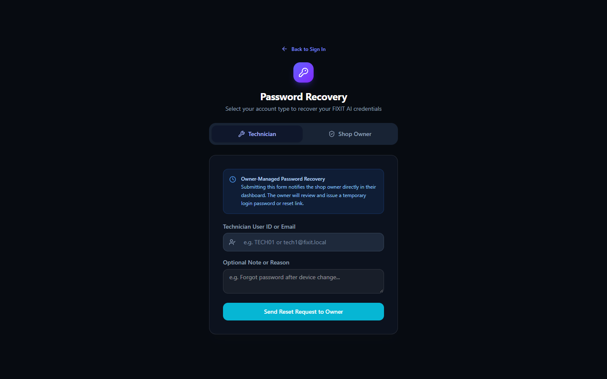

---

# Part 2 — Technician manual

## Signing in for the first time (technician)

You received a **User ID** (for example `TECH01`) and a **temporary password** from the shop
owner. Keep the password private — even from colleagues.

1. Open the shop's app address in any browser.
2. On the login page, choose the **Technician** tab.

   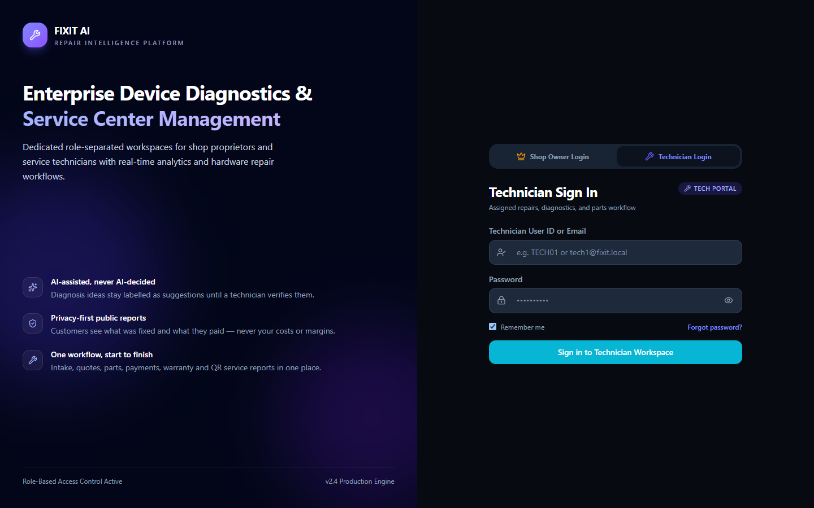

3. Enter your **User ID** or email and the temporary password.
4. Click **Sign in**.
5. The **Mandatory Password Update** window appears — this is normal on the first sign-in:

   

6. Type the temporary password, then choose your own new password (at least 8 characters)
   twice, and click **Update Password**.
7. You're in. Use your new password from now on — the temporary one no longer works.

> 🔑 **Forgot your password later?** On the login page click **Forgot password?**, choose the
> **Technician** card, enter your User ID or email, add a short note for the owner and submit.
> The owner approves it and hands you a new temporary password in person. See
> [Changing your password / forgot password](#changing-your-password--forgot-password).

## Your dashboard and assigned repairs

Your dashboard shows only your work — never the whole shop's money.

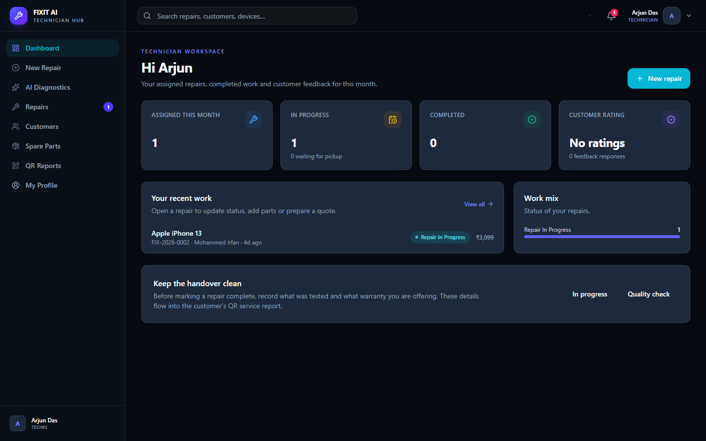

- **Your open repairs** — jobs assigned to you that are not finished
- **Today** — what changed on your jobs today

Open **Repairs** to see your job list. You only ever see repairs assigned to you.

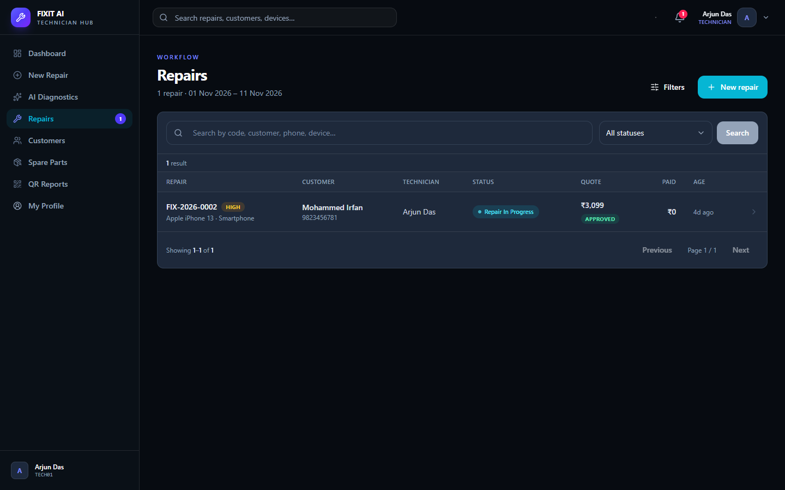

- Use the status filter (for example *Repair In Progress*) and the search box (customer name or
  `FIX-…` ID).
- Click a repair to work on it. The page has tabs:
  **Overview, Diagnosis, Parts, Quotation, Payments, Report, Activity**.

## Registering a customer and their device

You normally do this while starting a repair (see
[Creating a repair job](#creating-a-repair-job) — the 3-step wizard). Quick summary:

1. Click **New Repair**.
2. **Customer**: type the customer's phone number. If they exist, pick them; if not, type their
   name and phone — a new customer is created.
3. **Device**: choose the category, then brand and model. If the customer's device is already
   registered, pick it instead. Note the IMEI/serial if the customer can provide it — it proves
   which exact device is in the shop.
4. **Problem**: write what the customer reported, in their words. Add photos if you have them.
   Pick yourself under **Assign technician** so the job lands on your list.
5. Click **Create repair**. Note the repair ID (`FIX-…`) — it follows the job everywhere.

## Uploading device photos

Photos make diagnosis faster and protect the shop in disputes ("that scratch was already
there"). Add them anywhere you see a photo box — the repair wizard or the repair page:

1. Click the photo box (or drag photos onto it). You can pick several at once.
2. On a phone, you can also take a picture directly with the camera.
3. Each photo is uploaded and stored safely in the shop's Google Drive — only signed-in staff
   can view it.

**Good photos** = the whole device, the damaged area close-up, and any labels (model sticker,
IMEI). The AI identification works much better with sharp, well-lit photos.

## Running AI diagnostics

Open your repair and go to the **Diagnosis** tab (or use the **AI Diagnostics** page from the
left menu — see [Using AI diagnostics](#using-ai-diagnostics) in the owner manual; it works the
same for you).

1. Make sure the job has photos attached (see above). On the AI Diagnostics page,
   **Capture Device** uploads a photo and, when AI is configured, fills in the recognised
   brand/model — always verify it against the device in your hand.
2. In the repair's **Diagnosis** tab, click **Run AI research** (or **Generate checklist** for
   the offline version). The AI reviews the reported problem and returns possible causes with
   verification tests.
3. Treat the results as a **second opinion**. Combine them with the offline checklist and your
   own inspection.

> 🤖 If the shop has not configured AI, the AI button says "AI not configured" and the
> checklist + manual entry is the normal way to work. Nothing is blocked — you can always
> finish the repair.

## Confirming the fault

AI suggestions never become the official fault by themselves — **you** confirm it:

1. In the **Diagnosis** tab, review the AI suggestions and your own test results.
2. Write the **Confirmed fault** — the real problem you verified (for example
   *"Charging port corroded; battery tested OK"*).
3. Record what you did and the test results (for example *"Replaced port; charges at normal
   speed after 30-minute soak test"*).
4. Save. The confirmed fault is what appears on the customer's report, so keep it factual and
   in the customer's language where possible.

The job's status moves forward automatically as diagnosis completes (or you move it manually —
see [Updating repair status](#updating-repair-status)).

## Adding parts and recording payments

**Parts**

1. Open the **Parts** tab on the repair and click **Add part**. The window offers three ways the
   part was sourced:
   - **From Stock** — pick a part already in the shop's inventory (each option shows how many are
     in stock and the retail price). Enter the quantity and the customer unit price (it defaults
     to the retail price). Stock is deducted automatically and the movement is recorded in the
     ledger with the repair ID.
   - **Online Purchasing** — for parts ordered from a verified online distributor (iFixit,
     Amazon, and similar). You can search recorded supplier listings or enter a custom order —
     either way a **product URL** is required, so the price can be audited later.
   - **Offline Store Purchasing** — for parts bought from a local market shop: enter the shop
     name, address, bill number, warranty, cost and selling price. No URL needed.
2. Enter the quantity used and a short bench note if helpful.

   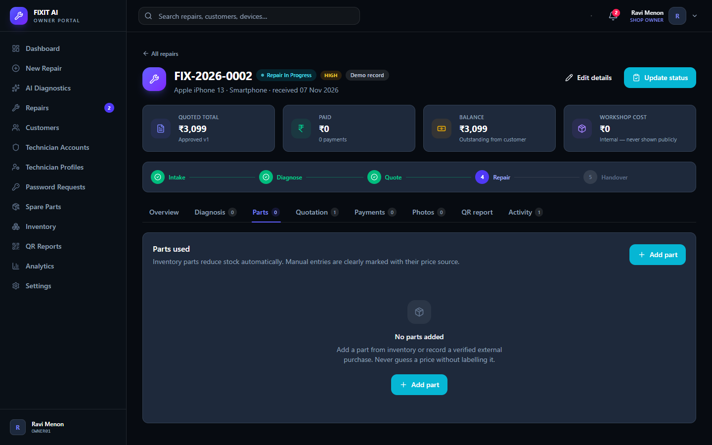

3. If a part must be ordered first, set the job status to **Parts Ordered** — the owner sees it
   in their overview and can order it.

**Payments** (only when the customer pays)

1. Open the **Payments** tab.
2. Click **Record payment**.
3. Enter the amount collected, the method (cash / card / UPI) and a reference if there is one
   (for example the UPI reference number).
4. Save. The balance shown on the repair updates immediately.

   

> 💡 Record a payment only when money is actually collected. These numbers feed the shop's
> revenue and profit reports.

## Updating repair status

A repair moves through a fixed set of steps (see
[Repair statuses explained](#repair-statuses-explained)). As a technician you move it forward
along the flow:

1. Open the repair's **Overview** tab.
2. The **Update status** control shows which next steps are allowed for the current status.
3. Choose the next status and confirm. Each change is recorded in the **Activity** tab with your
   name and the time.

Typical flow for you: *Device Received* → diagnosis → *Estimate Prepared* (after building the
quotation) → customer approval → *Parts Ordered* → *Repair In Progress* → *Testing & Quality
Check* → *Repair Completed* → *Delivered* when the customer picks it up.

If the customer declines the repair, move the job to **Cancelled** and write the reason in the
repair notes.

## Completing the repair and publishing the QR report

When the repair is done (status *Completed*, *Ready for Pickup* or *Delivered*):

1. Fill in the finishing details on the **Overview**/**Diagnosis** tabs: confirmed fault,
   repair procedure, testing results, and the warranty days if the shop gives one.
2. Make sure the **Quotation** is final (parts + labour) and payments are recorded.
3. Go to the **Report** tab and click **Publish service report** (if a report already exists,
   **Refresh report snapshot** updates it with the latest charges).

   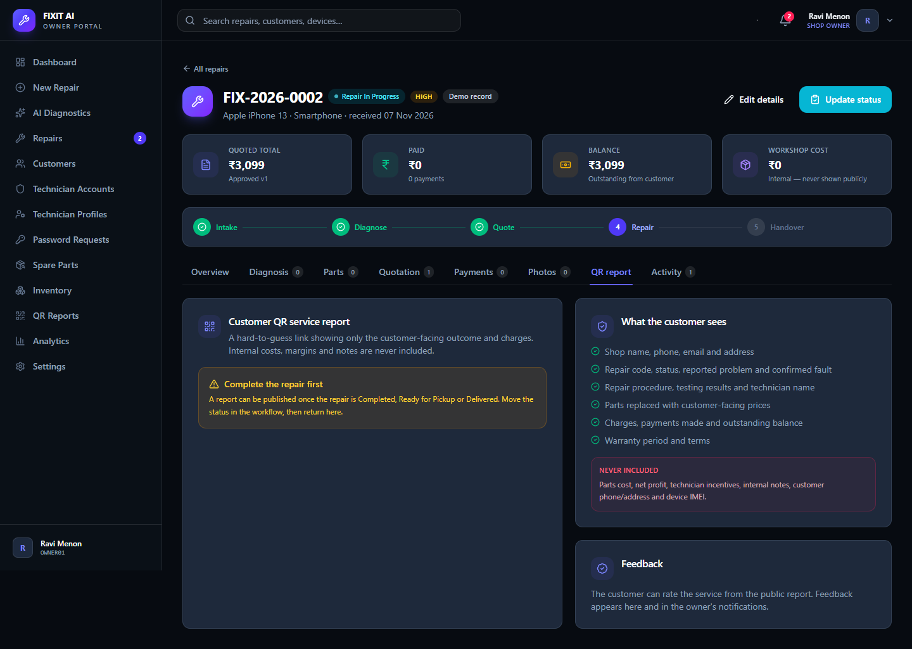

4. The app creates a private link (`…/r/<code>`) and a **QR code**:
   - Scan the QR with any phone camera to preview it
   - Print it for the customer's bill, or send the link to the customer
5. The customer opens the link without signing in and sees a clean, printable report: shop
   details, device, diagnosis, parts, the amount they pay and payments so far. They can also
   leave a star rating and a short comment (once).
6. If a link ever needs to be invalidated, ask the owner to use **Rotate** on the QR Reports
   page — the old QR stops working.

> ⚠️ The report deliberately hides purchase costs and profit — customers never see them.

## Viewing repair history

- **Your repairs**: the **Repairs** page keeps every job you ever worked on; use the search and
  status filters, or open a customer's page to see their full history.
- **In the spreadsheet**: your shop's Google Spreadsheet keeps each month's repairs in that
  month's tab (`November 2026`, …) with parts, payments and activity in the matching `- Parts`,
  `- Payments`, `- Activity` tabs.

## Changing your password / forgot password

**Change your password (signed in)**

1. Click your name / avatar (top right) and open **Profile**.

   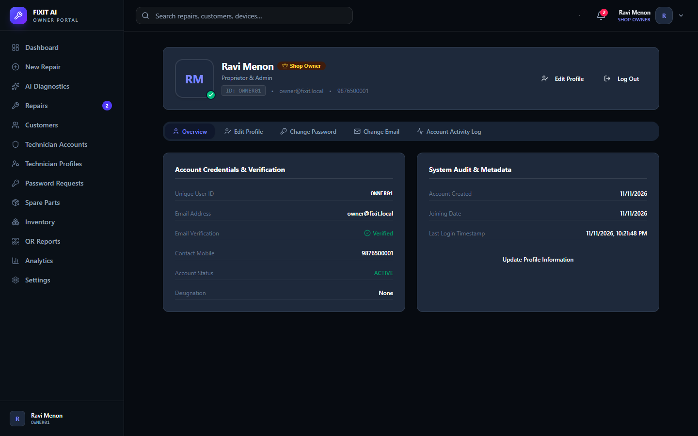

2. In the password section, type your current password, then the new one twice.
3. Save. Use the new password the next time you sign in.

**Forgot your password (signed out)**

1. On the login page click **Forgot password?**
2. Choose the **Technician** card.
3. Enter your **User ID or email** and a short note explaining (for example *"Phone repaired,
   forgot my password"*).
4. Submit. The owner receives your request in their **Password Requests** page.
5. The owner approves it and hands you a temporary password in person.
6. Sign in with it — you will immediately be asked to set your own new password.

---

# Reference

## Using FIXIT AI on your Android phone

FIXIT AI also installs as an Android app (**FIXIT-AI.apk**) — the same app you use on the
shop computer, on a phone. It opens the same login page, and everything you do in it is
saved to the same spreadsheet instantly. There is nothing extra to set up on the phone and
no separate password.

**Install once:**

1. On the phone, open the download link or scan the QR code in the repository's
   [Android app](README.md#android-app) section (stay signed in to GitHub — the
   repository is private).
2. Tap the downloaded file and allow the install when Android asks.
3. Open **FIXIT AI** from the app drawer and sign in with your usual User ID / email and
   password.

**Day to day:** use it exactly like the browser app — customers, repairs, photos,
diagnostics, parts and reports all work the same, and changes appear on every other device
(the app is a window onto the same server). If the phone loses internet, the app shows a
*"Can't reach the FIXIT AI service"* screen and reconnects by itself — nothing is lost,
because all data is stored on the server.

**Updates:** when a new version is released, open the same link on the phone and install
again — it updates over the old app and keeps you signed in.

## Repair statuses explained

Each repair moves through these steps. Technicians follow the flow in order; the owner may also
correct to any status (always audited).

| Status | Meaning |
| --- | --- |
| New Request | The job was just created |
| Device Received | The device is physically in the shop |
| AI Diagnosis Completed | The AI / checklist diagnosis step is done |
| Awaiting Technician Inspection | Waiting for hands-on inspection |
| Estimate Prepared | Quotation with parts + labour is ready |
| Awaiting Owner Approval | Waiting for the owner to approve the quote (big jobs) |
| Awaiting Customer Approval | Waiting for the customer to say yes |
| Parts Ordered | Waiting for a spare part to arrive |
| Repair In Progress | The repair is being done |
| Testing & Quality Check | Final testing before handover |
| Repair Completed | Work finished — report can be published |
| Ready for Pickup | Waiting for the customer to collect |
| Delivered | Customer has the device; job closed |
| Cancelled | Job cancelled (customer declined, or duplicate) |

A service report can be published from *Repair Completed*, *Ready for Pickup* or *Delivered*.

## Quick troubleshooting

| Problem | What to do |
| --- | --- |
| "Invalid credentials" at sign-in | Check the tab (Owner/Technician) matches your account, and the User ID spelling. Passwords are case-sensitive |
| Sign-in blocked after several tries | Wait a few minutes and try again — this is protection against guessing |
| A page shows "database not configured" / 503 | The shop's Sheets gateway needs attention — tell the owner; nothing you typed is lost |
| "Duplicate" warning when saving | The record already exists (for example that phone number). Search for it and edit it instead of creating again |
| Save fails with a gateway error | Wait a few seconds and retry. The app is built so a failed save never writes half of a record |
| Photos won't upload | Check the file is a normal photo (JPG/PNG) under the shop's size limit, then retry |
| AI buttons are disabled | AI is not configured in the shop — use the checklist and manual entry |
| QR link says "invalid or has been replaced" | The link was rotated or the report re-published — ask the owner for the fresh QR |

For anything else, the full technical troubleshooting table is in
[README.md → Troubleshooting](README.md#troubleshooting).

## Screenshot index

Every screenshot used in this manual (also available in `docs/screenshots/`):

| Screenshot | Where it appears |
| --- | --- |
| `login-owner.png`, `login-technician.png`, `forgot-password.png`, `mandatory-password-dialog.png` | Signing in & passwords |
| `dashboard-owner.png`, `dashboard-technician.png` | Dashboards |
| `repairs-list.png`, `repairs-technician.png`, `repair-detail-overview.png` | Repairs |
| `new-repair-wizard.png` | Creating a repair |
| `ai-diagnostics.png`, `repair-detail-diagnosis.png` | AI diagnostics & faults |
| `repair-detail-parts.png`, `repair-detail-quotation.png`, `repair-detail-payments.png` | Parts, quotes, payments |
| `repair-detail-report.png`, `qr-reports.png`, `public-report.png` | QR reports |
| `repair-detail-activity.png` | Audit trail |
| `customers-list.png`, `customer-detail.png` | Customers |
| `technician-accounts.png`, `technician-create-modal.png`, `password-requests.png` | Owner account management |
| `technician-profiles.png`, `technician-detail.png` | Technician performance |
| `spare-parts.png`, `inventory.png` | Parts & stock |
| `analytics.png` | Analytics |
| `settings-shop.png`, `settings-expenses.png`, `settings-audit.png`, `settings-data.png` | Settings |
| `profile.png` | Your profile |
